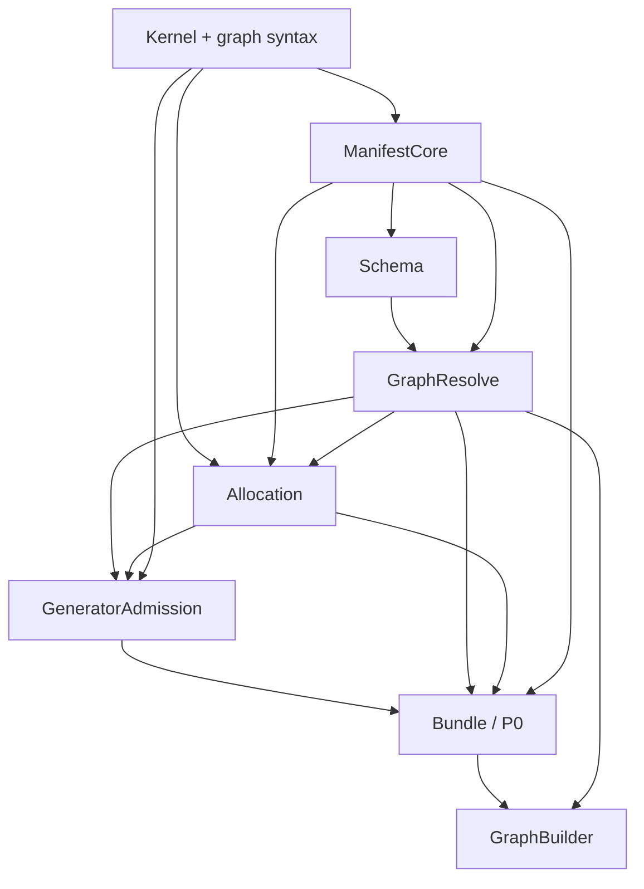

# A01 generator admission boundary review

**Scope:** review the proposed placement of the universal generator-admission
contract below Schema/GraphResolve/Allocation and above PinnedRegistryBundle.
Read-only review; no F* source or shared state changed. No theorem is claimed
proved.

## Verdict

This is the smallest sound ownership boundary found. It removes the
`GeneratorAdmission -> Bundle -> GeneratorAdmission` cycle while preserving
P0's requirement that the universal law belongs to the exact pinned callback.
It does require a real DAG reorder: P0/Bundle cannot remain before the schema,
resolver, allocation, and admission definitions it now consumes. In
particular, remove Bundle dependencies from GraphResolve and Allocation;
otherwise moving Bundle below admission creates a cycle.

## Minimal module dependency shape

`Allocation` may omit the `GraphResolve -> Allocation` edge if its plan
validity predicate is defined directly over canonical graph syntax and
manifest metadata. Either way it must not import `Bundle` if `Bundle` stores
the admission package. `GraphResolve` uses the canonical schema manifest; it
does not need executable callback lookup. The DAG currently lists `A07 ->
A04` and `A15 -> A04` even though the packet says these layers do not depend
on the complete Bundle. Those edges must be removed for the proposed ordering.

Recommended type ownership:

1. `GeneratorAdmission` defines a `GeneratorPackage` containing one
   `GeneratorRef` and its universal law. The law is stated over the exact
   callback field in that package and proves, for every legal input, run
   metric, and allocation, that its result descriptor is `SchemaSupported`
   and its child plan is valid/aligned.
2. `Bundle` stores a single table of these packages, not a callback table and
   a parallel law table. Its lookup/member result is the selected package
   itself (or a projection carrying that package), indexed by the canonical
   identity. `WorkMember`/registry-indexed `GeneratorMember` belong here if
   needed; they should be lookup results, not a second source of generator
   definitions.
3. P0 proves uniqueness, manifest-to-package projection in both directions,
   exact signature/codec/graph-codec coherence, and that the admission law
   returned by lookup is the law in the package for that selected callback.
   GraphBuilder consumes this exact lookup result. Generation/P2/P4 consume
   the package's law, never a separately looked-up theorem table.

This avoids callback extensional equality. Do not store `generate_graph`
twice and try to prove two functions equal; F* cannot generally decide or
derive that equality. The law should mention the package's own callback, and
consumers should execute/use that same package value. Identity equality alone
is insufficient if two package entries can reuse an identity.

## DAG consequences

Current order has `A04 (P0)` before `A05`–`A07`, `A15`, and `A16`; `A07` and
`A15` also currently depend on A04. That cannot implement this design as
written. The least disruptive dependency correction is:

- `A05`–`A07` use `A03`/ManifestCore and the prior schema nodes, not A04.
- `A15` uses canonical manifest/syntax/schema facts and does not depend on
  Bundle. If it needs exact operation maxima or generator metadata, those
  values must come from the canonical manifest projection, not a second
  package lookup.
- `A16` depends on `A07`, `A15`, and the kernel signatures, but not A04.
- `A04 (P0)` depends on `A03`, `A07`, `A15`, and `A16`; Bundle is then the
  join that stores packages plus their already-defined admission contract.
- `C1` moves after A04. A09 may remain after C1 if P0 takes the graph-codec
  law as a proof-bearing package contract and A09 proves the concrete syntax
  codec implementation. If P0 is intended to prove the graph codec's
  roundtrip itself, A09 must also precede A04; the spec/packet should choose
  one meaning and avoid a P0/A09 cycle.
- A08/GraphBuilder remains after both A04 and A16, and only consumes the
  selected package/member result. No edge from GeneratorAdmission to
  GraphBuilder or Generation is introduced.

P0 still means the whole pinned identity/package theorem. It is not weakened
to identity-only membership. This does move the P0 checkpoint later because
P0 now depends on schema semantics and allocation validity.

## Hidden obligations and risks

1. **Reload means exact package selection too.** The packet says P0 binds the
   law to the selected identity and that it survives abstract reload, while
   the P0 table in the spec says reload returns the same manifest. Same
   manifest alone does not prove the same callback/law package is selected.
   Clarify P0's reload clause as preserving the canonical identity-to-package
   association (including its law and pinned callback token), not merely
   reproducing manifest bytes. This need not compare functions extensionally:
   model reload as resolving the same pinned package entry/token.
2. **No bypass for generated graphs.** GraphResolve may establish that a
   descriptor is supported without proving a particular generator returns
   such a descriptor. The package law must quantify over every admissible
   input/metric/allocation and its exact callback. P4 then uses that law for
   the actual reconstructed input and allocation; a sample execution or
   resolver success alone cannot replace it.
3. **One schema predicate.** The admission law must use the same
   `SchemaSupported`/`dag_wf` defined by GraphResolve, and the same allocation
   validity predicate owned by Allocation. Avoid a generator-specific weaker
   predicate or a duplicate “well-formed graph” relation.
4. **Keep manifest/package projection singular.** ManifestCore defines
   canonical rows once. Bundle proves the package table is the exact
   projection of those rows. GeneratorAdmission defines package contents and
   its law; it must not invent another identity registry or serialization of
   closures/proofs.
5. **P0/P1 ownership remains distinct.** GraphResolve proves declarative
   schema judgment soundness/completeness; GraphBuilder proves public
   constructors sound/complete relative to that judgment. P1 is their
   composition. Neither GeneratorAdmission nor Bundle should duplicate P1.

## Reconciliation with packet and spec

The normative spec already requires the admission law to cover all legal
inputs and says it proves `SchemaSupported` plus a valid graph-local plan
(§2.2.1 and P4). The packet's current row for GeneratorAdmission is the
inconsistent part: it places the owner above Bundle and says Bundle supplies
membership, while also requiring Bundle to store/bind its proof. The proposed
split repairs that ownership contradiction without changing the theorem
statement or graph semantics. Packet wording should say that
GeneratorAdmission owns the package-and-law type independent of any registry;
Bundle owns registry-indexed extraction and P0's exact package binding.

Sources checked: `implementation_spec.md` §§2.2.1, 2.2.2, P0/P4; packet
§§2 and 3 (especially the type sketch, universal-admission explanation, and
module table); `state/work_dag.md` A04, A07, A15, A16, A08, and C1; A01's
`module_graph_audit.md`, `fsti_contract_audit.md`, and
`boundary_adversarial_review.md`.
