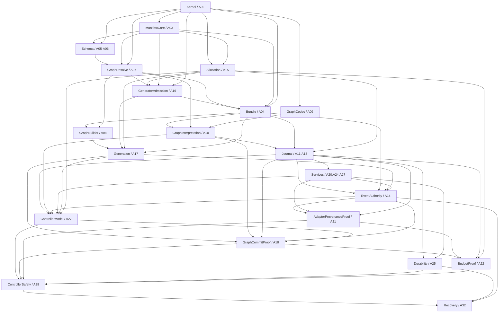

# A01 module boundary design

**Status:** complete as architecture; no F* theorem was proved here. This
document resolves the A01 reviews and fixes the A04/A16 dependency before
kernel work starts. The normative theorem meanings remain in
[`../../../implementation_spec.md`](../../schema_era_2026-10-14/implementation_spec.md); the module
packet is subordinate to it.

## Decision summary

- Keep a proof-oriented, acyclic module graph. Module boundaries follow
  definitions, proof witnesses, and theorem composition; they do not mirror
  the seven historical `.fst` files.
- P0 remains the exact relation between one canonical manifest and the
  executable package table. It includes the universal law attached to each
  generator, not merely the callback identity.
- Resolve the generator ownership cycle by making `GeneratorAdmission` a
  **pre-bundle package contract**. It imports the schema resolver and
  allocation model, but not `Bundle`, `GraphBuilder`, or `Generation`. Its
  `GeneratorPackage manifest` pairs one callback with a proof field that,
  for every legal input, metric, and parent allocation, its result is
  `SchemaSupported` and its plan is valid/aligned. `Bundle` stores these exact
  packages; P0 binds each package, callback, law, and identity in one table
  entry. `Bundle` then derives registry-indexed `GeneratorMember` and
  `WorkMember` evidence by exact lookup. No second admissions table exists.
- This preserves the original theorem strength: P0 binds the exact law to the
  pinned callback; P2/P4 consume that law. The package author supplies a
  checked proof as data. No sample run, global axiom, or post-hoc context
  proof substitutes for it.
- Do not prove equality of two generator function closures. The package law
  refers to the callback field in its own package, package tables contain one
  such record, and lookup returns that record together with a positional
  membership witness. Builder APIs consume the returned package value, so
  they do not accept a second callback that would need to be compared.
  Abstract reload preserves the same identity-to-package token/contract
  association; P13 connects that abstract token to a concrete loaded
  implementation.
- P0 binds law-bearing codec packages and their exact identities. A09 proves
  the graph-syntax codec implementation and its roundtrip/canonical laws;
  these are checked bodies satisfying the P0-facing codec contract, not a
  second P0 theorem or a reason for a P0/A09 cycle.
- A01 defines `.fsti` policy and ownership only. It creates no skeletal
  `.fsti`/`.fst` declarations; each stable interface begins with its API node
  and is paired with a checked implementation.

## Why the order changed

The packet previously assigned `GeneratorMember` to a module importing
`Bundle`, while also requiring the pinned bundle to store/bind that proof.
That creates an ownership cycle: the bundle needs the proof's type before it
can contain the proof, but the proof's module needs the completed bundle. The
DAG also put P0/A04 before A16, where that type was first defined.

The selected layering separates the package law from registry membership:

1. `GraphResolve` defines/proves the manifest-relative `SchemaSupported`
   judgment; `Allocation` defines graph-local plan validity without using the
   executable bundle.
2. `GeneratorAdmission` defines a generator package indexed by a manifest,
   with its callback and universal proof field together.
3. `Bundle` contains these packages and proves P0's exact package/manifest
   projection and identity coherence. Lookup derives the registry-indexed
   membership witness from the one stored package.

This makes the dependency order `A03 -> A05 -> A06 -> A07 -> A15 -> A16 ->
A04 -> C1`. A04 waits for precisely the proof language it must pin; A05-A16
no longer wait for C1. C1 remains a commit checkpoint after P0, before public
graph construction and interpretation. This is an explicit DAG refinement,
not a weakening or deletion of P0/A16.

Alternative considered: let P0 bind callback identity only and pass a
separate admission witness later. Rejected because it obscures which exact
law belongs to a pinned generator and introduces a second association path.
The package-field design keeps callback and law co-located and makes P0
verify the entire package projection.

## Acyclic proof/module dependency graph

An arrow means “imports”; the graph is a partial order. Independent siblings
may build in parallel. The active DAG controls milestone sequencing and
checkpoint commits.

The diagram omits independent supporting imports and optional P9 edges for
readability. The detailed owner/import matrix below is authoritative. Keep
these cycle prohibitions: `GraphResolve` never imports `Bundle`; `Allocation`
and `GeneratorAdmission` never import `GraphBuilder` or `Generation`; `Journal`
never imports `Services`, event authority, controller, or theorem modules;
`ControllerModel` never imports theorem conclusions or `BudgetProof`.

## Module ownership and imports

| Module | Owns | Imports / prohibition | DAG and theorem role |
|---|---|---|---|
| `WorkflowV2.Kernel` | Tagged identities; codec and indexed codec records; `CodeRef`, `OpRef`, generator callback signature; `Work`; graph/wire and schema AST syntax; artifact-ref syntax; charge metric | No bundle, journal, controller, runner, or host code | A02 foundation; no P theorem alone |
| `WorkflowV2.ManifestCore` | Canonical first-order manifest/schema entries, identity domains, exact projection encoding and uniqueness | Kernel only | A03; P0 foundations |
| `WorkflowV2.Schema` | `LegalEnv`, denotation, equality syntax/normalization, graph typing derivation syntax | Kernel + ManifestCore | A05–A06; P1 schema boundary |
| `WorkflowV2.GraphResolve` | Proof-producing resolver and dependent port telescope; `SchemaSupported` | Kernel + ManifestCore + Schema; no Bundle | A07; universal edge judgment and P1 resolver component |
| `WorkflowV2.GraphCodec` | Canonical first-order graph syntax codec | Kernel only; no package lookup | A09; syntactic half of P2 |
| `WorkflowV2.Allocation` | Graph-local plans, alignment/validity predicates, occurrence lifting, ledger projection functions | Kernel + ManifestCore; no Bundle/Builder/Controller (no resolver import needed for syntax-local plan validity) | A15; P4/P5/P8 support |
| `WorkflowV2.GeneratorAdmission` | `GeneratorPackage manifest`: exact callback plus universal schema-support and local-plan law | Kernel + ManifestCore + GraphResolve + Allocation; no Bundle/Builder/Generation | A16; explicit checked package premise consumed by P0/P2/P4 |
| `WorkflowV2.Bundle` | Exact executable package tables, manifest projection/reload, package membership lookup; registry-indexed `GeneratorMember` and `WorkMember` derived from exact entries | Kernel + ManifestCore + GraphResolve + Allocation + GeneratorAdmission | A04; P0 exact package/law/identity binding |
| `WorkflowV2.GraphInterpretation` | Decoded syntax resolved to exact dependent witness under one pinned bundle | GraphCodec + GraphResolve + Bundle | A10; P2 |
| `WorkflowV2.GraphBuilder` | Public `start_graph`/`add_node`/`finish_graph`, port telescope and construction completeness | Bundle + GraphResolve | A08; P1 builder component |
| `WorkflowV2.Generation` | Admitted pure generator execution, typed splice, global DAG and occurrence preservation | GraphBuilder + GraphResolve + Allocation + Bundle | A17; P4 splice component |
| `WorkflowV2.Journal` | Five events, `State`, guarded `apply`, canonical `replay`, structural `StateWF` | Bundle + GraphInterpretation + Allocation; no services/provenance/controller | A11–A13; P3 |
| `WorkflowV2.Services` | Explicit journaler, local/generator executor, adapter, scheduler, optional store contract records | Journal + abstract service data; no Controller actions/EventAuthority | A20/A24/A27; proof-bearing component inputs |
| `WorkflowV2.Durability` | Append history, crash cuts, load bytes/prefix and monotonicity | Journal + Services journaler contract | A25; P10 |
| `WorkflowV2.EventAuthority` | Authorized-event and local/generator/adapter origin witness shapes; `SemWF` history | Journal + Bundle + Services + Generation; definitions only | A14; no P6/P7 proof claims |
| `WorkflowV2.AdapterProvenanceProof` | Same-key effect safety and validated receipt provenance | EventAuthority + Services + Journal | A21; P7 |
| `WorkflowV2.Artifacts` (optional) | Typed resource projection, publication and restart-resolution laws | Kernel/Bundle + Journal + store contract | A23; P9 extension only |
| `WorkflowV2.ControllerModel` | Volatile attempts, `ControllerStep`, claims/frontier and commit visibility | Journal + GraphInterpretation + EventAuthority + Services + Allocation + Generation; no theorem modules/BudgetProof | A27–A28 definitions and claim lemmas |
| `WorkflowV2.GraphCommitProof` | Append-token-gated graph commit and child visibility | Generation + GraphInterpretation + Journal + EventAuthority + ControllerModel | A18; P4 composition |
| `WorkflowV2.LocalProvenanceProof` | Exact pure local output provenance and completion absorption | EventAuthority + Journal + Bundle + ControllerModel | A19; P6 |
| `WorkflowV2.BudgetProof` | Charge/fuel equations and once-only settlement | Allocation + Journal + Generation + GraphCommitProof + AdapterProvenanceProof | A22; P8 |
| `WorkflowV2.ControllerSafety` | Induction for every permitted bounded schedule | ControllerModel + GraphCommitProof + LocalProvenanceProof + AdapterProvenanceProof + BudgetProof + Durability; optional Artifacts | A29; P15 |
| `WorkflowV2.GraphRecovery` | Exact committed generated graph and lifted plan reuse | GraphInterpretation + GraphCommitProof + Journal + Durability | A26; P5, no P15 dependency |
| `WorkflowV2.Progress` | Enabled frontier and well-founded successful-append rank | ControllerModel + ControllerSafety + Journal + BudgetProof + Services | A30–A31; P11/P12; P12 does not use P15 |
| `WorkflowV2.Recovery` | Every-cut semantic recovered graph composition | GraphRecovery + Journal + Durability + ControllerSafety + EventAuthority + local/adapter/budget proofs; optional Artifacts | A32; P16 |
| `WorkflowV2.Refinement` | Concrete representation relation, step/load simulation | ControllerSafety + Durability + Progress + Services; optional Artifacts | A33; generic P13 theorem, no concrete instance |
| `WorkflowV2.Termination` | Conditional completion theorem | Progress + Refinement + explicit service-liveness premises | A34; P14 |
| `WorkflowV2.Examples` | Proof-bearing expressibility constructions | Public abstract API only | A35; examples do not replace theorem proofs |

### P0 and generator membership

`GeneratorAdmission` must be imported by `Bundle`, not the reverse. Its
package law is indexed by the exact manifest and refers to the callback field
in that same package. `Bundle` stores one whole package per generator identity
and proves the table is the exact manifest projection. Lookup returns that
package with a positional membership witness; `GeneratorMember` is derived
from this lookup result. Builder APIs consume that returned package, never a
second user-supplied callback. No detached law map, duplicate callback table,
or runtime sample exists. The manifest stores only first-order identity/schema
metadata; proof values remain executable-package contracts, not journal bytes.

P0's proof-bearing package inputs are explicit values. Constructing a
generator package requires constructing its universal law proof. P0 then
establishes exact identity association and restart-stable package lookup.
Reload preserves the package token and associated callback/law selection;
this is not an extensional equality claim between function closures. A future
P13 implementation must show that the concrete loader resolves the token to
the same pinned implementation. The abstract model does not claim host
binary identity for free.

## `.fsti`, build, and trust policy

- Use `.fsti` only where a downstream proof needs a stable abstract API.
  Kernel signatures and stable proof seams are candidates; private induction
  helpers and proof terms stay in `.fst`.
- Every project-owned `.fsti` declaration has exactly one paired same-module
  `.fst`, included and checked in the full build. Interface-only modules,
  unmatched `val`s, or moving an `assume` into an interface are not allowed.
  F*'s interface/implementation order constraints must be followed.
- Every system law is either proved in a checked body or appears as an
  explicit field/value of a caller-supplied contract record. A system theorem
  is proved parametrically from those values; it never imports a global
  project axiom for a service law.
- Keep a trust ledger for trusted F*/stdlib/solver primitives separately from
  project assumptions. No transitive P0–P16 closure may contain project
  `assume`, `admit`, unchecked external declarations, an unmatched interface,
  or an undischarged solver-only result. Audit declarations and imported
  dependency closure, not just text matches in the theorem module.
- Every full check starts with caches disabled, includes all `.fst` and paired
  `.fsti` in a topological source list, and treats all project warnings as
  errors. Record F*, Z3, and command/result. Examples are also verified but
  never substitute for generic laws.
- A01 creates architecture records only. Begin interfaces with A02 and
  create each `.fsti` together with its implementation/proofs and build entry.

## Historical source disposition

| Existing source | Future treatment |
|---|---|
| `WorkflowV2.Kernel.fst` | Retain useful identities/codecs/Work/graph syntax; split schema and artifact syntax only where a real proof boundary needs it. |
| `WorkflowV2.Identity.fst` | Split: first-order identity/manifest data to Kernel/ManifestCore; exact executable tables and P0 relation to Bundle. |
| `WorkflowV2.Graph.fst` | Replace admitted builder spine; separate resolver, plan/allocation, generator package contract, builder, splice and theorem compositions. |
| `WorkflowV2.GraphCodec.fst` | Reuse canonical syntax-codec lemmas if correct; keep typed reconstruction in GraphInterpretation. |
| `WorkflowV2.Journal.fst` | Rebuild as canonical events/replay/StateWF only; keep services, semantic witness types and proof composition downstream. |
| `WorkflowV2.GenerationExample.fst` | Reuse or replace as A35 example; never treat it as generic construction evidence. |
| `WorkflowV2.ChainProof.fst` | Reuse useful local lemmas as A35 illustration; never treat it as P1/A16/A17 proof. |

The A00 source inventory and all independent A01 reviews remain provenance.
The adversarial review's original blocker is preserved; this document records
the selected resolution and why it retains P0's exact-law guarantee.
