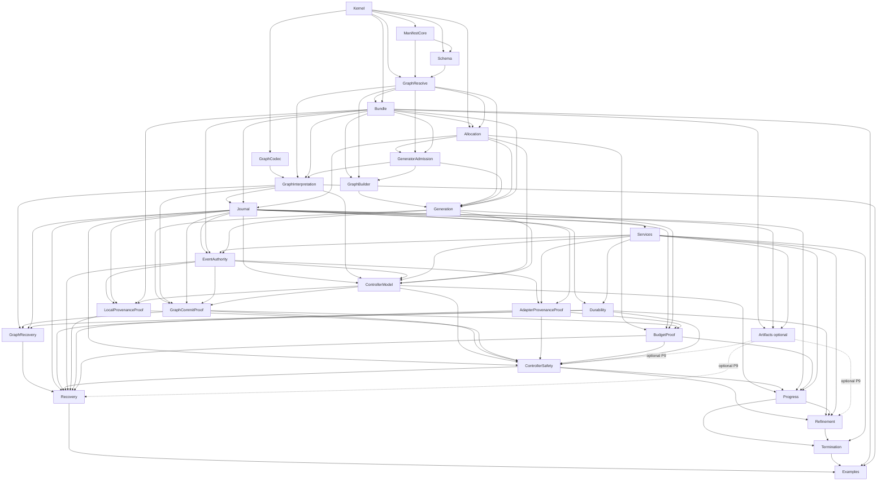

# A01 module/import graph audit

**Scope:** re-derived module dependencies and ownership from normative specification, implementation packet, A00–C6 DAG, and seven current modules. Architecture proposal only; no theorem completed, source or shared state changed.

## Recommended acyclic module graph

Packet's proposed ownership split can carry the P0–P16 proof spine without cycles if definition modules remain below theorem composition modules. Edges below mean “imports”; transitive edges omitted. This is a topological layer order, not an insistence that every node requires a separate physical file: adjacent implementation/proof nodes may be combined only if same import boundary and trust review remain clear.

This encodes packet constraints: `ManifestCore -> Schema -> GraphResolve -> Bundle`; `GraphResolve` does not depend on `Bundle`; `GeneratorAdmission` is below and independent of `GraphBuilder`; `GraphInterpretation` composes syntax codec + resolver + bundle; `Journal` imports no services, event authority, controller or theorem proofs; service contracts are beneath controller; P4, P8, P15, P16 are separate composition layers. Packet source of this graph: `implementation_packet.md:240-290`; DAG sequence/source owners: `state/work_dag.md:106-175,191-232`.

### Import edges, listed by owning module

- `Kernel`: none.
- `ManifestCore`: Kernel.
- `Schema`: Kernel, ManifestCore.
- `GraphCodec`: Kernel.
- `GraphResolve`: Kernel, ManifestCore, Schema. Must not import Bundle.
- `Bundle`: Kernel, ManifestCore, GraphResolve plus implementation package table definitions. Direction is resolved schema first, executable typed packages second.
- `Allocation`: Kernel, graph syntax, Bundle (only if plan validation resolves work kind); independent of GraphBuilder and Controller.
- `GeneratorAdmission`: Bundle, GraphResolve, Allocation. Must not import GraphBuilder or Generation.
- `GraphInterpretation`: GraphCodec, GraphResolve, Bundle, GeneratorAdmission.
- `GraphBuilder`: Bundle, GraphResolve, GeneratorAdmission.
- `Generation`: GraphBuilder, GraphResolve, GeneratorAdmission, Allocation, Bundle. No Journal.
- `Journal`: Bundle, GraphInterpretation, Allocation. No Services, EventAuthority, Controller or theorem modules.
- `Services`: Journal and abstract service data. No Controller action/frontier types or EventAuthority.
- `Durability`: Journal, Services journaler contract.
- `EventAuthority`: Journal, Bundle, Services, Generation. Definition layer only; no P6/P7 proof imports.
- `AdapterProvenanceProof`: EventAuthority, Services adapter contract, Journal.
- `Artifacts` (conditional): Kernel/Bundle, Journal, Services store contract.
- `ControllerModel`: Journal, GraphInterpretation, EventAuthority, Services, Allocation, Generation. No theorem modules or BudgetProof.
- `GraphCommitProof`: Generation, GraphInterpretation, Journal, EventAuthority, ControllerModel.
- `LocalProvenanceProof`: EventAuthority, Journal, Bundle/CodeRef contract, ControllerModel.
- `BudgetProof`: Allocation, Journal, Generation, GraphCommitProof, AdapterProvenanceProof.
- `ControllerSafety`: ControllerModel, GraphCommitProof, LocalProvenanceProof, AdapterProvenanceProof, BudgetProof, Durability; optional Artifacts for P9.
- `GraphRecovery`: GraphInterpretation, GraphCommitProof, Journal, Durability. No P15 dependency.
- `Recovery`: GraphRecovery, Journal, Durability, ControllerSafety, EventAuthority, LocalProvenanceProof, AdapterProvenanceProof, BudgetProof; optional Artifacts.
- `Progress`: ControllerModel, ControllerSafety, Journal, BudgetProof, Services.
- `Refinement`: ControllerSafety, Durability, Progress, Services; optional Artifacts.
- `Termination`: Progress, Refinement, adapter/store/service liveness laws.
- `Examples`: public abstract API, especially Bundle/GraphBuilder/GraphInterpretation/Recovery/Termination.

## Planned-module to DAG/theorem ownership

| Module | A-node owner(s) | Theorem owner/support |
|---|---|---|
| Kernel | A02 | Signatures/data foundation; codec laws; no P target alone |
| ManifestCore | A03 | P0 manifest projection/identity foundations |
| Schema | A05–A06 | P1 schema denotation/equality calculus |
| GraphResolve | A07 | P1 universal typed edge judgment; resolver component of P2 |
| GraphCodec | A09 | P2 syntax codec component only |
| Bundle | A04 | P0 exact package/manifest identity coherence |
| Allocation | A15 | P4/P5/P8 support, path lifting and plan/ledger projection |
| GeneratorAdmission | A16 | P0/P4 input contract binding, admitted graph/plan evidence |
| GraphInterpretation | A10 | P2 typed decode and exact witness reconstruction |
| GraphBuilder | A08 | P1 soundness/completeness |
| Generation | A17 | P4 typed graph splice/global DAG preservation |
| Journal | A11–A13 | P3 events, guarded transitions, codecs/replay/StateWF |
| Services | A20, A24, A27 | P7/P10 proof-bearing adapter/journaler/executor/service contracts; A27 uses generic scheduler laws |
| Durability | A25 | P10 every-cut durable prefix theorem |
| EventAuthority | A14 | P4/P6/P7/P15/P16 witness and SemWF definitions; no soundness theorem itself |
| AdapterProvenanceProof | A21 | P7 keyed receipt/effect provenance |
| Artifacts (optional) | A23 | P9 backing-object identity when claimed |
| ControllerModel | A27–A28 | P15 transition/action model and ready-input/claim lemmas |
| GraphCommitProof | A18 | P4 exact authorization and commit-gated visibility |
| LocalProvenanceProof | A19 | P6 exact local output and completion absorption |
| BudgetProof | A22 | P8 charge/fuel conservation and once-only settlement |
| ControllerSafety | A29 | P15 all-permitted-schedules safety |
| GraphRecovery | A26 | P5 exact graph/plan recovery |
| Recovery | A32 | P16 every-cut recovered semantic graph correctness |
| Progress | A30–A31 | P11 enabled frontier; P12 well-founded successful-append rank |
| Refinement | A33 | P13 generic concrete-to-abstract transfer theorem, not an instance |
| Termination | A34 | P14 conditional termination under explicit fairness/progress premises |
| Examples | A35 | Proof-bearing expressibility examples, not substitutes for generic theorems |

C0–C6 are commit checkpoints, not modules/theorems: C0 after A00; C1 after A04; C2 after A10; C3 after A13; C4 joins A18/A19/A21/A22/A23/A25/A26; C5 joins A29/A30/A31; C6 after A36. Checkpoint dependencies and “not a user gate” semantics are `work_dag.md:187-232`.

## Cycle audit / dependency boundaries

1. **Schema resolver and package bundle:** putting resolver inside Bundle while resolver looks up Bundle creates `Bundle <-> GraphResolve`. Keep schema/manifest resolver independent of executable package tables; Bundle consumes resolver (`implementation_packet.md:243-250,271-275`).
2. **Generator and builder:** putting `GeneratorAdmission` inside Generation or GraphBuilder while builder requires universal generator proof creates Builder/Generation recursion. Put admission below builder; Generation consumes builder (`:249-252,275-276`).
3. **Journal, services and semantic origins:** putting append provenance in Journal while Journal imports executor/adapter or controller creates Journal/Services/Controller cycle. Journal defines structural `StateWF`; EventAuthority defines witness shapes after Journal + Services. Services can mention event types, not Controller actions (`:253-259,277-280`).
4. **P4/P8:** if ControllerModel imports budget theorem or BudgetProof imports P4 composition that imports P8, cycle forms. ControllerModel owns ledger data/equations only. GraphCommitProof owns P4; BudgetProof then consumes P4/P7 results (`:259-263,281-285`).
5. **P4/P10/P15:** P4 must require successful serial append only; it must not depend on crash-cut P10 or all-schedule P15. ControllerSafety composes P4 with P10; keeps P4 independently provable (`:260,263`).
6. **P5/P16:** GraphRecovery is exact committed graph recovery and does not import P15; Recovery/P16 is later composition including ControllerSafety (`:264-265,285-286`).
7. **P12/P15/P14:** Progress owns both P11 and P12, but P12 rank theorem depends on transition/ledger facts, not ControllerSafety. Termination P14 is downstream of Progress + Refinement and liveness laws, so fairness cannot leak into safety (`:266-268`; DAG `work_dag.md:223-229`).
8. **Optional P9:** packed-reference syntax stays in Kernel; optional Artifacts imports Journal/store contracts. Only P15/P16/Refinement get conditional artifact edges. Avoid Journal importing Artifacts if that module imports Journal (`implementation_packet.md:258,287-288`; DAG `work_dag.md:167-168`).

## Current seven-module disposition

Current import graph is acyclic in Makefile order: `Kernel` roots `GraphCodec` and `Identity`; `Graph` imports Kernel+Identity; `GenerationExample` imports Kernel+Graph+GraphCodec+Identity; `ChainProof` imports Kernel+Graph+Identity+GenerationExample; `Journal` imports Kernel+Identity. Evidence: source module headers (`src/WorkflowV2.*.fst:1-8`) and `Makefile:5-6`. Preserve concepts selectively; do not preserve current file boundaries as semantic commitments. Packet explicitly says current files are partial historical evidence and names future dispositions (`implementation_packet.md:234-238,292-301`).

| Current file | Disposition | Future owners / caution |
|---|---|---|
| `WorkflowV2.Kernel.fst` | Retain and extend, then separate syntax/schema/artifact syntax if necessary. | Kernel/A02, ManifestCore/A03; keep all durable signatures single-sourced. Current graph syntax and work signatures are useful. |
| `WorkflowV2.Identity.fst` | Split. | Equality/tagged first-order identity fields into Kernel/ManifestCore; package tables, exact manifest projection and pinned lookup into Bundle. Current `Graph -> Identity` dependency must not pull GraphResolve into Bundle. |
| `WorkflowV2.Graph.fst` | Major split/replacement of admitted builder spine. | Syntax/typed graph resolution into GraphResolve; allocation to Allocation; generator admission to GeneratorAdmission; typed builder to GraphBuilder; splice to Generation; selected theorem compositions to proof modules. Keep useful telescope only after universal schema proof path is clear. |
| `WorkflowV2.GraphCodec.fst` | Retain syntax-only codec if laws survive audit. | GraphCodec/A09. Add GraphInterpretation separately; never claim canonical syntax parse is typed P2. |
| `WorkflowV2.Journal.fst` | Rebuild/extend below services and provenance. | Journal/A11–A13 structural events/replay only; move external services and event-origin witness types/proofs out. |
| `WorkflowV2.GenerationExample.fst` | Keep or replace as example after generic API exists. | A35; seed for Nat codec/chain. Do not treat example table as Bundle implementation. |
| `WorkflowV2.ChainProof.fst` | Keep or replace as proof-bearing example. | A35; chain graph/admission proof illustration, not A08/A16/A17 universal result. |

## Build order sufficient for this graph

Topological layer order: (1) Kernel; (2) ManifestCore, GraphCodec; (3) Schema; (4) GraphResolve; (5) Bundle and Allocation; (6) GeneratorAdmission; (7) GraphInterpretation and GraphBuilder; (8) Generation; (9) Journal; (10) Services; (11) Durability, EventAuthority, Artifacts; (12) AdapterProvenanceProof; (13) ControllerModel; (14) GraphCommitProof and LocalProvenanceProof; (15) BudgetProof and GraphRecovery; (16) ControllerSafety; (17) Recovery and Progress; (18) Refinement; (19) Termination; (20) Examples; (21) integrated trust/full-check A36. Independent siblings can be built in parallel once listed imports exist. This refines planned A-order, allowing syntax-only GraphCodec to proceed from C1 while schema branch works, as DAG already specifies.

The seven-module Makefile order is currently topological, but it cannot implement this architecture as-is: one `Graph` unit currently combines prospective resolver/builder/allocation/admission boundaries, and no `.fsti` or module proof split exists. Planned module names/import constraints are in packet §3; A00–C6 sequencing is in `work_dag.md:104-175`.
