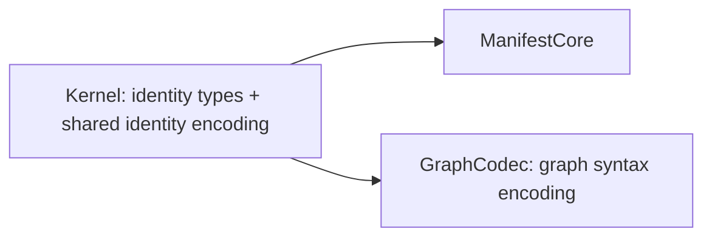

# A03 source migration review: shared identity codecs

**Scope:** read-only audit of the current `GraphCodec` identity encoders and
proofs, their users, and the approved A01 dependency graph. No source files
were changed and no verifier was run for this report.

## Decision

Move the reusable first-order byte primitives and identity codec layer into
`WorkflowV2.Kernel`, then have `WorkflowV2.GraphCodec` consume those exported
definitions. Keep graph-specific syntax encoders/decoders and graph roundtrip
proofs in `GraphCodec`.

This preserves A01's acyclic graph exactly:

Do not make `ManifestCore` import `GraphCodec`; that would reverse the planned
A03/A09 dependency and make manifest identity reuse depend on the graph codec.
Do not duplicate a second identity encoding in `ManifestCore`.

## Current code and exact proof inventory

`WorkflowV2.GraphCodec.fst` currently owns both generic byte machinery and
identity encoding. Its first block is the shared foundation:

- Lines 10–35: `enc_nat`, length-framed `enc_seq`, `dec_seq`, `dec_nat`, and
  `dec_len_seq`.
- Lines 37–107: string encoding/decoding and suffix roundtrip proofs:
  `enc_chars_length`, `char_int_roundtrip`, `dec_chars_encoding`,
  `seq_items_decode_encoding`, `sequence_decode_encoding_suffix`,
  `sequence_decode_encoding`, `dec_string_encoding_suffix`, and
  `dec_string_encoding`.
- Lines 109–114: append associativity lemma `append_assoc_local`.

The identity layer follows:

| Lines | Encoder / decoder / theorem |
|---|---|
| 116–150 | `enc_codec_identity`, `dec_codec_identity`, `codec_identity_decode_encoding_suffix`, and full-input `codec_identity_decode_encoding`; line 119 has definitional expansion lemma `enc_codec_identity_def`. |
| 152–176 | `enc_code_identity`, `dec_code_identity`, `code_identity_decode_encoding_suffix`. |
| 178–206 | `enc_operation_identity`, `dec_operation_identity`, `operation_identity_decode_encoding_suffix`. |
| 208–236 | `enc_generator_identity`, `dec_generator_identity`, `generator_identity_decode_encoding_suffix`. |
| 238–266 | `enc_graph_codec_identity`, `dec_graph_codec_identity`, `graph_codec_identity_decode_encoding_suffix`. |
| 268–299 | tagged `work_identity` encoder/decoder and `work_identity_decode_encoding_suffix`. Tags are `0=code`, `1=operation`, `2=generator`. |
| 301–326 | tagged `output_identity` encoder/decoder and `output_identity_decode_encoding_suffix`. Tags are `0=value codec`, `1=generated graph codec`. |
| 328–360 | `durable_work_ref` encoder/decoder and `durable_work_ref_decode_encoding_suffix`. |

The identity roundtrip results are **suffix** left-inverse theorems of shape
`decode (encode id @ suffix) == Some (id, suffix)`. These are what nested
framed graph fields need; they are stronger and more reusable than only
full-input decoding. Explicit `*_decode_encoding` full-input theorems exist
only for codec identity in the current source. ManifestCore should preserve
suffix laws and can derive full-input laws by applying them to `[]`.

Graph syntax starts at line 362 (`enc_wire`) and should stay in `GraphCodec`.
The wire parser calls shared `dec_codec_identity` at lines 383–387, and the
wire roundtrip proof calls `codec_identity_decode_encoding_suffix` at lines
540–542. The surrounding `wire_decode_encoding_fuel` proof is graph-specific
(lines 522–573), so only its identity helper dependency moves.

## Every current consumer

Within `GraphCodec.fst`, consumers are:

- The durable reference codec at lines 329–360 uses `enc/dec_work_identity`,
  `enc/dec_codec_identity`, `enc/dec_output_identity`, and their suffix laws.
- `enc_wire` and `dec_wire_step` at lines 362–402 use codec identity encoding
  for `ConstantWire`.
- `wire_decode_encoding_fuel` at lines 538–547 invokes the codec identity
  suffix theorem.
- The later graph-node/descriptor encoding and roundtrip proofs consume
  `enc_durable_work_ref` / `dec_durable_work_ref` and its suffix law; these
  remain available by importing Kernel after the move.

No other current source module calls `enc_*_identity` or
`*_identity_decode_encoding_suffix`; `rg` finds all direct uses in
`WorkflowV2.GraphCodec.fst` only. `WorkflowV2.Identity.fst` compares identity
records and resolves packages using boolean equality; it does not serialize
them. `WorkflowV2.Journal.fst` stores `registry_identity` as a field but has
no registry encoder. `GenerationExample.fst` has the sole current literal of
`registry_identity` (lines 189–190), so changing that record to exact
canonical-manifest bytes requires migrating that example. `Kernel.fst` defines
the identity types, including `registry_identity` at lines 10–77.

There are no current codecs for `schema_identity`, `charge_metric_identity`,
`artifact_type_identity`, `artifact_store_identity`, or `registry_identity`.
A03's manifest encoder must add encodings for the complete set of manifest
identity domains (including newly introduced domains from the spec), and must
not treat the old GraphCodec subset as complete.

## Concrete migration outline

1. Keep identity type declarations in Kernel (current `Kernel.fst` lines
   10–85). Add identity record wrappers required by A03 there before defining
   their encoders.
2. Move the byte/string primitive block (current GraphCodec lines 10–114) to
   Kernel, or place it in a clearly named Kernel section. ManifestCore needs
   the same length framing and string treatment; a private copy in either
   module would create a second source of truth.
3. Move identity-specific definitions/proofs from GraphCodec lines 116–360
   into Kernel, extending them for all manifest identity types. Preserve
   suffix roundtrip theorems. The first-order encoders can be generic over
   `(name, version, build)` fields internally, with small typed wrappers per
   identity record; retain explicit typed theorem names at the public layer.
4. Leave `durable_work_ref` encoding in Kernel if it is considered part of
   identity/reference syntax, as it depends only on Kernel types and the moved
   helpers. Otherwise it may stay in GraphCodec, but then GraphCodec must
   continue exposing a durable-reference suffix theorem and ManifestCore must
   not reuse that wrapper codec. Keeping it in Kernel is simpler and avoids
   pulling graph syntax into the manifest module.
5. Delete the moved definitions from GraphCodec and rely on `open
   WorkflowV2.Kernel`. Leave graph syntax (`enc_wire`, node and graph
   encodings, parser fuel, graph-specific suffix proofs) in GraphCodec.
6. Update A03/Makefile ordering only if needed: current `MODULES` already
   verifies Kernel before GraphCodec (Makefile line 6). Add ManifestCore after
   Kernel; GraphCodec and ManifestCore remain siblings and each imports Kernel.

Kernel can use `FStar.List.Tot`, `FStar.List.Tot.Properties`, `FStar.String`,
and `FStar.Char`, currently opened by GraphCodec at lines 3–6. This adds
foundational encoding lemmas and standard-library dependencies to the Kernel
module, but introduces no project-module cycle. It does not make Kernel
responsible for graph encoding or executable package resolution.

## Alternatives and tradeoffs

1. **Duplicate identity encoders in ManifestCore — reject.** This violates
   A03's one-source-of-truth requirement. A future format change could make
   the same identity serialize differently in a graph node versus a manifest.
2. **Have ManifestCore import GraphCodec — reject under current plan.** It is
   acyclic only if GraphCodec remains Kernel-only, but A01 explicitly makes
   ManifestCore and GraphCodec Kernel-only siblings. It also makes the
   foundational registry identity depend on graph serialization (A09),
   contrary to A03 being an early independent foundation.
3. **Create a new identity-codec module — possible but unnecessary redesign.**
   If it imports Kernel to access identity types, Kernel cannot itself use its
   codec to define `registry_identity`, and both ManifestCore and GraphCodec
   would gain a new dependency. If the new module instead owns identity types
   too, that contradicts A01's Kernel ownership and requires a module-graph
   change. The current A03 task explicitly allows adding fields at Kernel's
   owner boundary, so no extra module is needed.
4. **Keep generic framing in GraphCodec and reimplement only identity wrappers
   in ManifestCore — reject.** The wrappers depend on the same framing/string
   rules, so this still duplicates format decisions or requires GraphCodec to
   export low-level helpers to ManifestCore.

## Proof and verifier friction to expect

- `Kernel.fst` is first in the Makefile module list. A syntax/type issue or a
  harder list/string proof there fails every downstream module. Move the
  already-proved lemmas mechanically first, then add new identity domains in
  small verified increments.
- Current record encoders are manually duplicated. `enc_codec_identity_def`
  at line 119 explicitly exposes right-associated append shape; the other
  suffix proofs rely on F* normalization without parallel `*_def` lemmas.
  Generalizing to a shared `(name, version, build)` helper may change
  associativity goals. Preserve explicit expansion lemmas and test each typed
  wrapper before migrating all wrappers.
- Existing suffix laws use exact structural equality on `list nat`, and
  `char_int_roundtrip` depends on `FStar.Char`'s code-point invariant. Moving
  imports may alter qualified names or solver normalization; no octet, UTF-8,
  filesystem, or hash property follows from these mathematical-list proofs.
- The existing identity lemmas prove decoder left-inverse of encoder, not the
  converse canonicality law for arbitrary accepted encodings. A03 still needs
  to prove injectivity (straightforwardly from suffix roundtrip) and any
  canonical-manifest decoder acceptance theorem separately. Do not label the
  existing lemmas full codec canonicality.
- Tagged sums need disjoint tags and branch-specific constructor equality;
  the current `work_identity_decode_encoding_suffix` and
  `output_identity_decode_encoding_suffix` cover the encoder direction only.
  A03's valid-manifest sorting/duplicate and lookup proofs are not supplied by
  these codecs.
- Registry exact-byte identity must avoid a recursive definition. Define
  `registry_identity` as a wrapper/alias for canonical manifest bytes, and
  `manifest_identity m` from the canonical manifest encoder. Manifest entries
  may mention schema and package identities but should not themselves contain
  the containing registry identity. A decoder/validity predicate for
  `manifest_named_by` can be layered after canonical encoding; it must not be
  required to compute the identity itself.
- The current `registry_identity` record's fields are referenced only in its
  `GenerationExample` literal (and the abstract field types in Journal and
  Identity); source migration is small, but downstream theorem signatures may
  still rely on record equality or record construction syntax. Search all
  consumers before changing it.

## References

- A01 ownership/import matrix and dependency DAG:
  `state/research/A01-2026-10-13/module_boundary_design.md`, especially lines
  77–105 and the matrix near lines 150 onward.
- A03 requirements and identity policy:
  `state/research/A03-2026-10-14/task_brief.md`, items 1–7 and proof acceptance.
- Existing schemas and byte assumptions:
  `src/WorkflowV2.Kernel.fst` lines 7–85; `src/WorkflowV2.GraphCodec.fst`
  lines 10–360.
- Build ordering:
  `Makefile` line 6.
