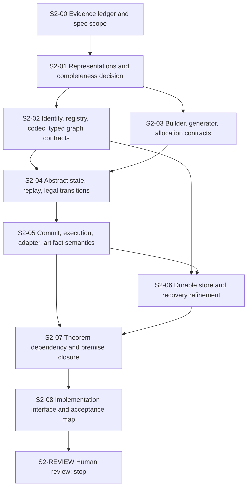

# F* v2 spec-refresh DAG audit

## Scope and disposition

Goal for next DAG: finish an abstract, implementation-ready formal system/spec that a later agent can implement. This DAG must author no F* source and execute no implementation DAG node. Existing `.fst` files are read-only evidence. Deliver a revised normative specification plus proof-obligation/assumption registry and implementation interfaces; stop at human review. “Implementation-ready” means unambiguous state, transition, representation, theorem, and refinement contracts, not proved F* theorems or runnable implementation.

Current DAG is implementation-shaped: V2-03 requires executable resolver and proofs; V2-04 onward targets replay, runner, store, artifacts, progress (work_dag.md:52-62). Reusing it would keep an unmet implementation acceptance as gate to spec writing. Retire it from active scheduling by logged DAG revision, preserve all current statuses/history, create new IDs `S2-*` all `not_started`. Do not mark V2-03 complete or imply existing proof interfaces discharged P0/P1. `state.md` status block and current-summary paragraphs must be revised atomically with the DAG; append run-log revision and leave old summary sections intact.

## Reusable source evidence and limits

| Existing material | Reusable in abstract spec | Does not establish |
|---|---|---|
| Three work forms, dependent input/output, codec laws, generated descriptor plus allocation plan: `WorkflowV2.Kernel.fst:89-187` | API vocabulary and candidate type signatures. `GraphDesc` contains first-order syntax, no closures/values (`Kernel.fst:76-87`). | Runtime extraction, actual host build identity, registry manifest binding, or any workflow transition theorem. |
| Structural identity comparison and exact list membership lookup: `Identity.fst:84-164,203-282`; work-derived durable ref at `Identity.fst:50-82` | Lookup contract: successful result includes exact package membership and label equality. | Registry uniqueness is merely a record field (`Identity.fst:100-104,203-207`); no manifest ID-to-content binding or cross-restart reload (`Identity.fst:284-292`). Identity equality cannot recover existential type equality. |
| Typed wire witness, concrete port telescope, typed sequence and prefix-edge lemmas: `Graph.fst:304-415,600-739` | Syntax-directed typing judgment, prior-port discipline, structural dependent pairs/projections, induction shape. | Raw decoded wire syntax does not construct the witness; node input must match fixed Work input for every port environment. No generic type equality decision. |
| First-order finite DAG, `dag_wf`/`graph_wf`, typed witness projection: `Graph.fst:10-16,763-797` | Candidate abstract graph model and explicit distinction between raw syntax and typing evidence. | `wire_label_isomorphic` is weaker than dependent typed isomorphism; `graph_complete` only states a target and is admitted. Builder boundary and laws also open (`Graph.fst:417-425,523-543,906-956`). |
| Structural graph byte codec, complete input parsing and canonicality: `GraphCodec.fst:455-485,635-645` | Durable syntax codec contract, canonical byte boundary. | Codec decodes `graph_desc`, not `graph_wf`/typed witness. No manifest-backed resolver or graph completeness. |
| Input-sized chain example and universal admission: `GenerationExample.fst:139-158`; `ChainProof.fst:105-115,252-323` | Example proves non-fixed graph shape; exact example registry; graph well-formedness and allocation validity for all input/parent values. | Generic generator correctness, generic resolver, root/generated restart proof, or builder P1. This is one homogeneous chain only. |
| Event and action vocabulary: `Journal.fst:47-112` | Names, fields, occurrence key, `(run,sequence)` identity; supports abstract transition design. | Replay, legality, action authorization, `WF`, commit atomicity, recovery, or terminal absorption. Journal comments explicitly say no authority yet (`Journal.fst:101-112`). |

### Exact open theorem/contract gaps to allocate

- P0: manifest identity must bind exact work/codec/graph-codec entries; uniqueness must be constructed/proved; root input and graph codec resolve from same snapshot; define host reload/build refinement. Current gap: `Identity.fst:100-104,203-207,284-292`; `node_summaries.md:247-253`.
- P1/P2: choose supported graph/type representation and state its completeness boundary; prove soundness, completeness, typed isomorphism, builder preservation/completeness, and exact resolver behavior. Current builder assumptions/admissions: `Graph.fst:417-425,523-543,906-956`; unresolved arbitrary equality: `node_summaries.md:297-312`.
- P3-P14: specify replay/WF, graph commit/substitution, completion no-rerun, adapter correlation, resource settlement/artifact persistence, every-cut storage, progress/fairness, runner refinement, conditional termination. Existing source currently has only journal vocabulary and generator admission; map from old acceptance at `work_dag.md:55-62`, with theorem meanings in `implementation_spec.md:1157-1179` and premise inventory at `implementation_spec.md:1189-1217`.

## Proposed acyclic DAG (spec work only)

Dependency meaning: edge `A -> B` means B cannot begin until A is complete. No human-gate node in middle; final review is output stop, not a scheduled executable gate. All listed nodes write spec/state artifacts only. Existing `V2-*` statuses preserved as historical implementation statuses.

| ID | Depends | Spec-only deliverable and completion test |
|---|---|---|
| S2-00 | — | Evidence ledger with source locations, historical/current distinction, P0-P14 target list, fixed non-goals. Classify every existing claim as proved source lemma, checked declaration, admitted/assumed boundary, research candidate, or host premise. |
| S2-01 | S2-00 | Decision record for type-recovery language: select schema + validated graph-local certificate (current candidate), or another route; define expressiveness and rejection behavior. State exact supported completeness theorem. Address graph-specific dependent equalities; explicitly reject identity-only casts and Work execution as type discovery. |
| S2-02 | S2-01 | Normative representation contracts: manifest and pinning; root decoding; canonical graph syntax; typed resolver judgment and soundness/completeness; typed graph isomorphism; builder API laws. State P0/P1/P2 assumptions and proof targets separately. |
| S2-03 | S2-01 | Normative generator and allocation interface: pure callback, input/allocation quantification, graph and node-aligned plan validity, occurrence lifting, budget conservation, commit input. Reuse chain as example only. |
| S2-04 | S2-02,S2-03 | Abstract machine state as replay of append-only events; event legality, enabled actions, `WF`, terminal states, deterministic replay, legal-prefix and preservation contracts. Define no hidden durable state. |
| S2-05 | S2-04 | Transition contracts for root/child commit and substitution, local completion and reuse, external intent/outcome safety, artifacts and resource ledgers. Specify authorization and result-validation predicates, not implementations. |
| S2-06 | S2-02,S2-05 | Store model and refinement premises: canonical serialization, atomic append/latest prefix, monotone durability, every crash cut, recovery exactness, pinned manifest reload. Name excluded media loss/rollback/corruption. |
| S2-07 | S2-05,S2-06 | Complete P0-P14 theorem matrix with dependency edges, precise statements, premises, owners/discharge evidence. Separate safety, progress, liveness, fairness, finite-crash assumptions. No top-level theorem may hide an open obligation. |
| S2-08 | S2-07 | Later-agent implementation packet: module/interface decomposition, data/schema formats, transition pseudocode, proof order, conformance acceptance checks, unresolved risks. Trace every interface and acceptance item to normative clauses and source evidence. |
| S2-REVIEW | S2-08 | Present complete spec package to user and stop. Only after explicit resume may new implementation DAG be designed. |

All S2 nodes begin `not_started`; this audit creates no S2 completion. For project state consistency, DAG table and Mermaid must match; `state.md` must say legacy V2 implementation remains paused at V2-03 `in_progress`, S2 spec refresh proposed/approved according to actual user action, and no source changes. Append rationale to `run_log.md`; add summaries only when S2 nodes actually start. Do not rewrite prior V2 summaries or claim historical checks cover new spec contracts.

## State-hub consistency changes proposed (not applied)

1. `work_dag.md`: preserve existing V2 table/diagram as “legacy implementation DAG, paused”, preserve exact statuses; add separate S2 diagram/table with fresh IDs and the scope restriction above. State explicit active DAG field to avoid two competing readiness rules.
2. `state.md`: replace present tense “V2-03 is in progress; after it…” control text with historical status plus active spec-refresh objective. Normative implementation spec remains source of truth until S2 explicitly delivers and user accepts a revised normative spec; do not silently amend it.
3. `node_summaries.md`: no change to historical V2 summaries. Add S2 summary only after started; link current audit/evidence ledger. Preserve source check claims and their stated limits.
4. `run_log.md`: append DAG revision explaining scope change, retained V2 statuses, why no V2 node is marked complete, S2 IDs/status initialization, and no source edits/execution. Never rewrite past log claims.

## Caveats

- Audit was read-only for repository; requested artifact saved outside repo. No F* source edited, no DAG node executed, no tests/checks run.
- Existing `implementation_spec.md` is normative, but current DAG descriptions sometimes describe requirements more strongly than declarations prove. New spec should deliberately replace or amend it only through an explicit reviewed revision.
- Research reports contain superseded alternatives. Current candidate is schema plus small validated certificate, but it is not selected/normative: run_log.md:15-25, 417-429; state.md:147-159. Avoid treating candidate recommendation as decision.
- User's acceptance target is spec completion, so implementation/proof closure is explicitly downstream. Do not report P0-P14 achieved as a result of this DAG.

## Strongest objection

This proposal may over-constrain the type system by choosing a schema/certificate language and thereby weaken “every finite typed DAG” completeness. Current evidence says arbitrary erased `Type0` equality cannot be generically recovered; schema/certificate routes only cover representable equalities (`node_summaries.md:302-312`; `run_log.md:397-407,417-426`). Resolve objection at S2-01 by either proving the intended universal representation route or explicitly narrowing theorem scope with user-visible rationale. Do not label restricted completeness as the original P1.
