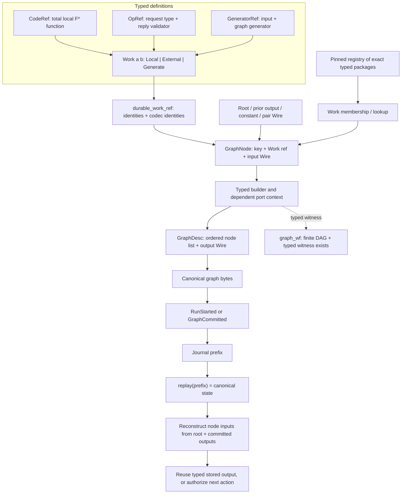
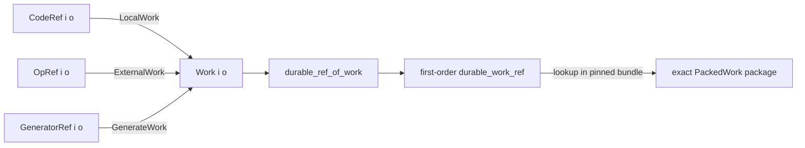
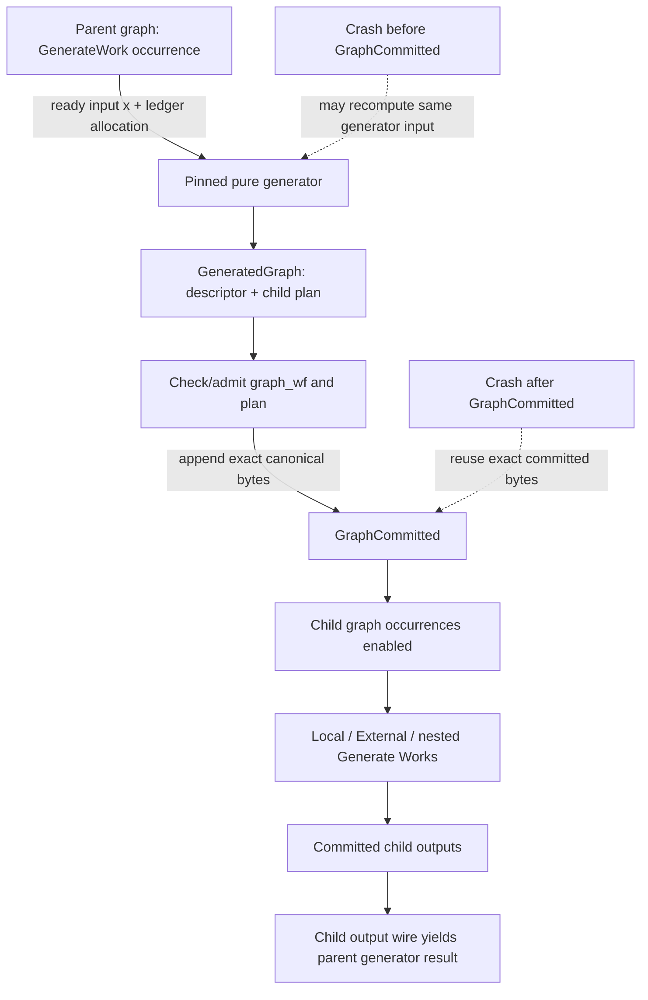
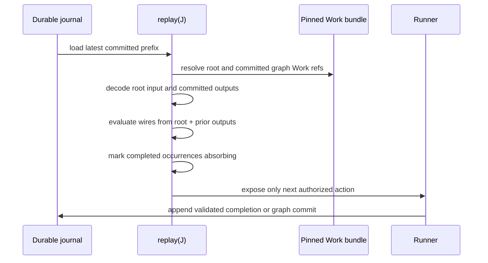

# F* v2 graph and recovery guide

This guide explains the graph declarations and their intended execution/recovery path. It follows the current V2 source and the contracts in the implementation spec. It does not change either one.

## First: what does “the journal is well-formed” buy us?

Your intuition is right **if well-formedness includes semantic provenance**. A committed node output is the durable result: recovery reconstructs that node's input, decodes the saved bytes at the exact dependent output type, and reuses the value. It does not call the local function again. For an external operation, it reuses a committed outcome; the outside operation is not assumed pure.

There are two facts a proof must keep distinct:

- **Structural validity:** events form a legal canonical history; references and occurrence keys line up; bytes decode at the right types; budget transitions are valid.
- **Semantic provenance:** a local completion was the result of its pinned code on that input; an external outcome passed the pinned validator and belongs to its intent; a graph commit is the exact graph produced by its pinned generator.

Canonical bytes prove their encoding is well formed. They do not, by themselves, prove a local output is the function's result. The **spec requires** an append authorization proof that ties each local output to the pinned function and reconstructed input, each external outcome to its intent and validator, and each child graph to its generator result. If the initial run is trusted and every append goes through that verified path, an append-only store preserves this semantic provenance at every crash cut. Under that invariant, recovery need not rerun completed work or re-prove semantic authorization from scratch; it decodes the stored output and reuses it.

That does **not** mean “load arbitrary bytes and trust them.” The store needs a trusted genesis and a refinement proof that only authorized appends can enter the durable prefix. Recovery still parses canonical events, resolves pinned identities, reconstructs typed inputs, and decodes output bytes at the exact indexed type. If journals can be imported from an untrusted source, their provenance must be checked or authenticated first.

The source-level event records currently contain bytes and identities. The journal module says replay/transition proofs are still future work. The guide therefore distinguishes the specification's intended proof from what the current F* files have already proved. See [Journal.fst](../current_implementation/src/WorkflowV2.Journal.fst#L47), [the replay contract](implementation_spec.md#L756), and [append authorization](implementation_spec.md#L891).

## The whole path at a glance



Solid lines are runtime data flow in the model. The dotted line is a proof relation: the first-order descriptor alone does not contain the typed witness.

## 1. Work definitions and identities

### Codecs

- A plain **codec a** encodes and decodes values of type a, with round-trip and canonicality laws.
- An **indexed codec i o** is indexed by an input value x. Its decoder has type bytes -> option (o x). That is how recovery decodes a dependent result at the actual input.

These are in [Kernel.fst](../current_implementation/src/WorkflowV2.Kernel.fst#L90).

### The three executable Work forms

A Work has one fixed input type and an output type family that may depend on the input value:

    work : (input:Type0) -> (input -> Type0) -> Type

The constructors are:

- **LocalWork:** wraps a CodeRef. Its run field is a total F* function x -> output x. It has input and indexed output codecs.
- **ExternalWork:** wraps an OpRef. It has a request codec, a reply validator x -> bytes -> option (output x), and a charge maximum. The external effect itself may be nondeterministic; only an accepted reply is turned into a typed output.
- **GenerateWork:** wraps a GeneratorRef. Given input x and an allocation, it returns a graph descriptor and a child allocation plan. The generated child graph's output wire supplies the eventual output x.

The declarations are in [Kernel.fst](../current_implementation/src/WorkflowV2.Kernel.fst#L110), [the Work sum](../current_implementation/src/WorkflowV2.Kernel.fst#L177), and [identity derivation](../current_implementation/src/WorkflowV2.Identity.fst#L50).

A durable work reference contains a kind/version identity plus input/output codec identities. It is derived from the Work; the graph does not separately store an executable closure. The pinned registry packages heterogeneous Works and looks up the exact typed package for a durable reference. Registry identity must be tied to the exact package manifest by the still-open P0 proof.



A node label stores that first-order reference. At execution/recovery, the pinned bundle supplies its typed implementation. See [packed work lookup](../current_implementation/src/WorkflowV2.Identity.fst#L79).

## 2. Graph syntax versus typed graph evidence

A **GraphNode** stores three first-order fields:

    key
    durable_work_ref
    input_wire

A **GraphDesc** stores a list of these nodes and one output wire. It stores no function, runtime value, or proof object. See [Kernel.fst](../current_implementation/src/WorkflowV2.Kernel.fst#L76).

The descriptor is deliberately only syntax. Although its F* type is indexed by an expected output family, `wire input x` itself does not encode the value type of each intermediate wire or prove that the final wire has that output family. The `durable_work_ref` also contains identities rather than the existential F* package. `graph_wf` supplies the missing relation: the descriptor's interpreted DAG has an existential `typed_graph_witness` that resolves every Work and wires each port at its exact type. This is why “the bytes parse as a GraphDesc” is weaker than “the bytes denote a typed graph.”

The node list is interpreted in topological order. Keys identify nodes within this graph occurrence. An OutputWire names an earlier node; when a graph is committed, local keys are paired with the containing graph occurrence to make globally unique node occurrences.

### Wire forms

| Wire | Meaning | Type evidence |
|---|---|---|
| RootWire | The graph's input value x | Has type input |
| OutputWire key | A prior node's output | A typed port reference carries its output family |
| ConstantWire(codec, bytes) | A literal stored by canonical bytes | Pinned codec lookup supplies its type/value |
| PairWire left right | Pair two wire values | Builds a dependent pair type; right may depend on left |
| FstWire pair | First part of a pair | Preserves the left type |
| SndWire pair | Second part | Its type may depend on the first value |

Syntax is declared in [Kernel.fst](../current_implementation/src/WorkflowV2.Kernel.fst#L63). The typed wire constructors and evaluators are in [Graph.fst](../current_implementation/src/WorkflowV2.Graph.fst#L304).

### The typed wiring object

A Wiring bundles three aligned things:

    wiring_syntax   : wire input x
    wiring_eval     : port_environment -> family(environment)
    wiring_typed    : wire_typing_witness for that syntax and evaluator

This is the bridge from compact durable syntax to a typed value expression during graph authoring. For example, root_wiring returns x; port_wiring reads a value from a typed port reference; pair_wiring constructs both the syntax and dependent pair evaluator. See [Wiring](../current_implementation/src/WorkflowV2.Graph.fst#L374) and [its constructors](../current_implementation/src/WorkflowV2.Graph.fst#L433).

The port environment is a dependent telescope, represented as nested dependent pairs. Each new node adds a port whose type can depend on the previous environment. If a node has Work type `a -> b` (where `b : a -> Type0`) and its input wire evaluates to `v`, the new output port has type `b v`. Thus the value-indexed output type is preserved in the graph's type. For example, a Work can have output family `fun n -> { k:nat | prime_after n k }`; its output codec must decode a value and proof of the input-indexed refinement at the actual input `n`.

For an `OutputWire key`, the key looks up the corresponding port in this telescope. Its type is not guessed from the key: it comes from the `TypedNodesSnoc` step that created that port. That step records the exact Work `a -> b` and the typed input Wiring, so the port type becomes `b (eval_wiring input prior_env)`. The next node's input Wiring is checked against its own fixed input type before `add_node` can extend the telescope.

One important API detail: the current add_node contract requires the input wire to have one fixed Work input type a in every port environment. The output type may depend on the actual wired input; the consumer's input type does not itself vary with the prior port environment.

## 3. Adding Works and forming a graph

The intended authoring sequence is:

1. Start with a root-only port context.
2. Choose a Work and its exact membership in the pinned registry.
3. Build a typed input Wiring from the root, prior ports, constants, or pairs.
4. Add the node. Its fresh key is the current node count; its output family extends the port telescope.
5. Finish with an output Wiring whose type is the graph's declared output family at root input x.

The contract for add_node is roughly:

    ref      : Work a b
    input    : Wiring over prior ports with type a
    result   : new builder + PortRef for output b(input)

The proof object TypedNodesSnoc mirrors each such step: it contains the prior typed sequence, fresh key, exact Work package/membership, and input Wiring. A TypedGraphWitness connects the sequence and final output Wiring to the first-order graph syntax. Finally, graph_wf requires the finite-DAG facts and existence of this typed witness. See [typed sequence](../current_implementation/src/WorkflowV2.Graph.fst#L600), [typed graph witness](../current_implementation/src/WorkflowV2.Graph.fst#L763), and [graph_wf](../current_implementation/src/WorkflowV2.Graph.fst#L795).

This is how local, external, and generator Works become graph nodes: all use the same add_node shape. Their Work kind controls execution and durable identity; their input Wiring controls where the typed input comes from.

In schematic authoring notation, the construction is:

```text
inc    = LocalWork increment_code
scan   = ExternalWork scan_operation
repeat = GenerateWork repeat_generator

b0 = start_graph root_input
b1, p0 = add_node b0 inc    member_inc    (root_wiring root_input)
b2, p1 = add_node b1 scan   member_scan   (port_wiring p0)
b3, p2 = add_node b2 repeat member_repeat (port_wiring p1)
g       = finish_graph b3 (port_wiring p2)
```

This is explanatory pseudocode, not a compiled example: the real F* calls also carry implicit dependent indices and membership proofs. `port_wiring p0` is only legal when `p0`'s output type matches the next Work's input type. A pair or projection can be used when the desired input is assembled from multiple ports. The shipped concrete example constructs a repeated-increment graph; the external Work is represented in the core types but this file set does not yet provide a complete runner example for it.

## 4. How dynamic graph generation works

A generator is itself an ordinary Work node in its parent graph. When it becomes ready, the runner reconstructs its input x and exact ledger allocation, then calls its pinned total generator:

    generate_graph x allocation
      -> { generated_descriptor : GraphDesc ... x;
           generated_child_plan : GraphAllocationPlan }

The child descriptor can choose node count, Work identities, wires, fan-out, and joins based on x and allocation. Since nodes are an ordered list and wires refer backward, each committed child graph is a finite DAG. The allocation plan is aligned with graph-local node keys and checked against the parent fuel/charge. In the current Kernel API the generator itself is `Tot`: topology is a pure, reproducible function of the typed input and allocation. Nondeterministic or effectful work belongs in `ExternalWork`, whose result is not assumed to be a function of its request.

Admission requires a proof for every generator input/allocation that the returned descriptor is graph_wf and its child plan is valid. The specification then commits the exact canonical graph bytes and lifted occurrence plan before enabling child nodes. Before that commit, a crash may recompute the pure generator from the same committed arguments. After it, recovery uses the exact committed graph bytes; it must not choose replacement topology. A GenerateWork has no NodeCompleted output event. Its result is read from the child graph's output wire after that child graph finishes.

The source example is a chain generator: input n creates n increment nodes. For n = 3, its first node reads root value 3, the second reads node 0, the third reads node 1, and its output wire selects node 2. The chain proof constructs the exact typed witness and proves graph_wf plus allocation validity for every n and parent allocation. This demonstrates one input-shaped graph family, not the general theorem that every finite typed DAG is constructible.



The source-level generator and proof are in [GenerationExample.fst](../current_implementation/src/WorkflowV2.GenerationExample.fst#L139) and [ChainProof.fst](../current_implementation/src/WorkflowV2.ChainProof.fst#L66).

## 5. How node inputs and outputs are recovered

The journal is a sequence of canonical events, not a snapshot of an in-memory process. Its intended canonical state is S = replay(J).

- **RunStarted** stores the root input bytes, root graph bytes, registry/codec identities, budgets, and root allocation plan. The spec requires authorization to start from the typed root graph supplied by the run entry point and prove those bytes are its canonical encoding.
- **GraphCommitted** stores the generator occurrence, exact child graph bytes, and lifted allocation plan. The spec requires authorization to start from the parent graph: reconstruct that generator occurrence's typed input and ledger allocation, resolve its pinned generator, and prove these bytes are the canonical encoding of that exact generator result.
- **NodeCompleted** stores the node occurrence, output bytes, and artifact references.
- **CallIntent** stores the stable external-call key and resume data.
- **CallOutcome** stores the validated output bytes, evidence, charge, and artifacts.

Node inputs are derived rather than repeated: resolve the node's durable Work reference from the pinned bundle, evaluate its input wire from the root value/constants and completed predecessor outputs, then use that Work's codec at the resulting input. Output bytes are decoded with that same input index. For a local completion, the decoded value is the durable cached result. For an external completion, validation is at the exact reconstructed request input. For a generator, the committed child graph and its output wire determine the result.



A completed local node is not rerun after its NodeCompleted event has crossed the store's commit point. A crash before that point can repeat the computation, because its result was still volatile. If an append committed but its acknowledgement was lost, recovery sees the completion and reuses it. This is exactly-once journaled completion and recovery reuse, not exactly-once physical execution across the pre-commit crash window.

An external operation has a different window: the adapter may have performed an effect after CallIntent but before CallOutcome. Recovery resumes the same intent/key under the adapter contract; no purity or determinism of the external system is assumed.

## 6. What a semantic journal-WF invariant lets recovery avoid rechecking

A ghost proof invariant can record facts about the authorized append history without storing proof objects in event bytes:

    HistoryWF(J) =
      legal_canonical_replay(J)
      /\ each root graph was admitted as graph_wf before RunStarted
      /\ each completion was authorized for its reconstructed input
      /\ each external outcome was validated and correlated with its intent
      /\ each committed child graph was the exact admitted generator result
      /\ ledgers, occurrences, and artifact references satisfy their invariants

The key append contracts are schematically:

    authorize_root(g, bytes):
      graph_wf(bundle, x, g)
      /\ bytes = encode_graph(x, g)

    authorize_graph_commit(x, allocation, result, bytes):
      result = generator.generate_graph(x, allocation)
      /\ graph_wf(bundle, x, result.descriptor)
      /\ allocation_plan_wf(result)
      /\ bytes = encode_graph(x, result.descriptor)

    authorize_local_completion(x, y, bytes):
      y = code_ref.run(x)
      /\ bytes = encode_indexed(x, y)

The actual contracts use pinned identities, occurrences, reconstructed inputs, and exact event fields. They also cover external validation and store append authorization.

Then prove:

1. HistoryWF([]) (or a trusted run genesis is well formed).
2. Each semantically authorized append preserves HistoryWF.
3. Every crash cut loads a committed prefix and preserves that history invariant.
4. Graph/value codec round-trip and canonicality identify the decoded value/descriptor with the one admitted at append.
5. Replay is deterministic and computes the unique state from that prefix.

Under those premises, recovery need not rerun local computations or re-prove semantic graph authorization from arbitrary syntax. It reuses the ghost fact established when the bytes were authorized. This is the formal role of the “ghost state” approach; the proof lives in the store/refinement invariant, not in serialized proof bytes. Root and child graphs have different authorization sources (run entry point versus parent generator plus ledger), but both must establish the same `graph_wf` relation before commit and both face the same reconstruction need after restart.

### What that ghost fact does not automatically implement

`graph_wf` is a proposition that says a typed witness exists. It does not itself produce an executable function table after restart. Ghost provenance can discharge the *semantic re-admission* question only if the store refinement preserves authorization for the exact byte prefix. The runner still needs exact pinned Work lookup and a verified interpreter/dispatcher that reconstructs each ready node's typed input and calls the matching Work. That concrete reconstruction and execution path still needs proof.

In the current spec, P2 explicitly asks an executable resolve_graph to reconstruct a typed graph, and the journal spec says recovery decodes and resolves graph bytes. Your preferred ghost route is a potential simplification of that proof boundary, but the spec has not yet been revised to replace P2. Keep the distinction clear: “no need to recheck semantic graph validity” does not mean “no runtime graph interpretation.”

## 7. Proof and implementation status

The current source has useful typed declarations and one proved dynamic example. It is not yet a complete workflow runner:

- The three Work records, durable references, graph syntax, port telescope, typed Wiring constructors, DAG predicate, and journal event shapes are declared.
- The chain example proves one typed graph and a pinned generator admission for every input/allocation. The repository state records that all seven current modules passed F* verification.
- Graph syntax round-trip/canonicality is proved. It establishes byte-level syntax properties, not typed resolution.
- General GraphBuilder operations are opaque/assumed; builder laws, finish_graph_sound, and graph completeness contain admits.
- Journal replay, append authorization, and the concrete durable store are still specified contracts, not implemented in WorkflowV2.Journal.fst. Its final comment explicitly says V2-04 will define replay.
- There is no complete runner or generic resolver for arbitrary decoded descriptors yet.
- Registry identity-to-exact-manifest binding is still a P0 obligation.

The general theorem that arbitrary finite typed DAGs can be built from the minimal node/wire forms remains P1. The general recovery theorem needs the graph provenance path and verified dispatch refinement; codec canonicality alone cannot supply either.

For exact proof obligations, see [implementation_spec.md](implementation_spec.md#L1163), [the current state](state_summary.md#L1), and [the latest node summary](../history/node_summaries.md#L384).

