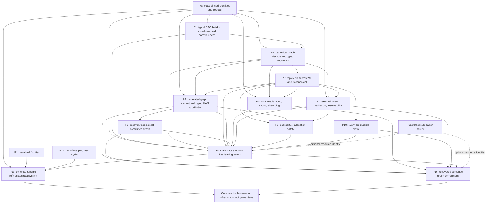

# Key correctness theorems for F* v2

This note explains the correctness claims required by the abstract v2 system and how they fit together. It is a proof-goal guide, not a claim that the source proofs are complete. The normative targets P0–P16 are in the [implementation spec](implementation_spec.md).

## The central distinction

There are two different claims here, and recovery must preserve both.

1. **Dependent graph typing:** every node input wire has exactly the input type accepted by that node, and every output port has the output type indexed by that node's actual input value. This is the producer-to-consumer compatibility concern.
2. **Result provenance:** the value recorded for a node was authorized by that node's contract: it is the result of the pinned local function, a reply accepted by the external validator, or the output of the committed child graph produced by the pinned generator.

The spec treats these as distinct obligations: graph typing/resolution (P1/P2), operation-specific result provenance (P6/P7), abstract authorization across all permitted execution interleavings (P15), and recovery of that semantic history at every durable cut (P16). P13 is the later concrete-runtime refinement theorem. A value may have the right type and still be the wrong result of the intended computation. Conversely, showing that a local function returned a value does not prove that the graph's consumer accepts that value's dependent type. The combined end goal is **recovered semantic graph correctness**: the graph is typed, recorded node values satisfy their operation contracts, and replay reconstructs the same typed inputs and results at every durable prefix.

Canonical encoding is a third, separate fact. It says accepted bytes uniquely represent their decoded value. It does not prove that a value is the result of the right computation or that its type matches a downstream node. The indexed codec contracts are in [Kernel.fst](../current_implementation/src/WorkflowV2.Kernel.fst#L90).

## The type-level objects involved

The core work signature has one input type and a result type family indexed by the input value:

```fstar
Work A B
(* B : A -> Type0 *)

CodeRef.run : x:A -> Tot (B x)
```

An external operation has no purity or determinism requirement. Its validator returns either no accepted result or a value at the same indexed type:

```fstar
validate_reply : x:A -> reply:bytes -> Tot (option (B x))
```

These declarations are in [Kernel.fst](../current_implementation/src/WorkflowV2.Kernel.fst#L99) and the `Work` sum is at [Kernel.fst:177](../current_implementation/src/WorkflowV2.Kernel.fst#L177).

For a node `k`, let its resolved work be `Work A_k B_k`. Its input wire is interpreted in the environment of the root and earlier node outputs. Write that environment as `ρ`, and the actual input as:

```text
x_k(ρ) = evaluate_input_wire(k, ρ) : A_k
```

The output port created by this node then has type:

```text
B_k(x_k(ρ))
```

That is the dependent part: the port's type can change with the runtime value supplied to the node. The typed port context and wire witnesses are declared in [Graph.fst](../current_implementation/src/WorkflowV2.Graph.fst#L150); `TypedNodesSnoc` records the node's exact work and input wiring at [Graph.fst:600](../current_implementation/src/WorkflowV2.Graph.fst#L600).

The durable graph is not this typed context. `GraphDesc` stores only a node list, durable work references, wire syntax, and an output wire; it contains no executable functions or typed witness ([Kernel.fst](../current_implementation/src/WorkflowV2.Kernel.fst#L63)). `graph_wf` relates that syntax to a finite typed DAG and requires an existential `typed_graph_witness` ([Graph.fst](../current_implementation/src/WorkflowV2.Graph.fst#L763), [Graph.fst:780](../current_implementation/src/WorkflowV2.Graph.fst#L780)).

## The strict dependent-edge theorem

For a producer node `p` and a consumer node `c`, the consumer's entire input wire must type-check as the input type required by `c`. If the wire is a direct `OutputWire p`, this reduces to checking the producer port's dependent type against the consumer input type. For a pair, projection, or constant, typing is recursive: the whole producer output need not be the whole consumer input.

If `p` resolves to `Work A_p B_p`, then in the producer's prior-port environment `ρ_p`, its output type is `B_p(x_p(ρ_p))`. If `c` resolves to `Work A_c B_c`, the input wire must evaluate to an `A_c`. For a direct `OutputWire p`, graph construction is accepted only if compatibility follows uniformly from the declared types and static graph context:

```text
forall ρ in LegalEnvironments(G).
  output_type(p, ρ) = B_p(x_p(restrict_to_producer_prefix(ρ, p)))
  and output_type(p, ρ) = A_c by conversion or equality derivable
      from the declared types and static graph-context constraints
```

This is a universal graph property, not a proof payload supplied by a node. The graph checker may reason from the signatures, refinements, and static constraints that define `LegalEnvironments(G)`, but it must not inspect a run's outputs, ask an external operation or adapter to justify an edge, or require an edge-specific/context-dependent proof field. If the equality cannot be established from that static information for every legal environment, graph construction/resolution rejects the graph. For the current `Work A B` interface, `A_c` is one fixed input type for that node. Pair and projection wires are checked recursively by their type rules; they do not create an escape hatch for a mismatched direct producer output. The spec states the all-environments edge rule ([implementation_spec.md:691](implementation_spec.md#L691)) and typed graph invariant ([implementation_spec.md:1034](implementation_spec.md#L1034)).

In the schema language, `Refine(T,P)` binds the candidate value tested by `P`:
`P` is scoped under a value of type `T`, and its denotation is the subset
`{z:T | P(z)}`. This is a local binder in the declared type, alongside the
value binder in a `Sigma` codomain. A refinement fact used by graph typing
must be obtained from membership in that exact declared type and substituted
at the exact port value. It does not let a validator narrow the values
quantified by `LegalEnvironments(G)` or supply a graph-specific edge proof.

This is a static safety claim, not a prediction of a runtime value. For a producer input family, the claim ranges over every value allowed by its declared type and the graph's static constraints. It may not use a value produced during execution to choose a coercion or establish that the edge is well typed.

### `vector n` feeding a `vector 3` consumer

Suppose a producer is:

```fstar
produce : n:nat -> Tot (vector n)
```

and the consumer is:

```fstar
consume : vector 3 -> Tot result
```

If the producer's input is any `n:nat`, its output has type `vector n`. A direct edge to `consume` is accepted only if the producer's declared input type/static graph constraints establish `n = 3` for every legal environment, so that F* can derive the type equality from those declarations. If `n` can be arbitrary, the graph is rejected. It is not enough that one execution happens to produce `n = 3`, and a codec round-trip proof does not establish the required equality.

Ways to express a type-correct workflow include:

- **Make the producer type force length three.** For example, its input type or the graph's static input constraints may ensure `n = 3` for every legal environment. The equality then follows from the declared types; no runtime observation or node-carried edge proof is involved.
- **Use a length-generic interface.** Have producer and consumer agree on a fixed package type such as `Σ n:nat. vector n`. The consumer can process any length after unpacking it. This is a different consumer signature; it does not make the original `vector 3` consumer accept the package.
- **Represent validation as explicit work, if desired.** A separate Work may accept the package and return a result such as `option (vector 3)`. The graph checks its declared input/output types like any other node. This is an explicit value-level check with an explicit fallible result; it does not provide evidence that makes the raw package-to-`vector 3` edge valid.

For the dynamic external case, if an operation's output is `Σ n:nat. vector n`, that whole sigma package is its declared output type. A consumer expecting `vector 3` cannot connect directly, even if the external service might happen to return a package whose witness is `3`. The external operation, its validator, and its adapter are not asked to prove `n = 3` for graph construction. If the graph needs a consumer that accepts all returned values, that consumer must accept the sigma type; if it needs a length-three value, the graph must obtain that type from static declarations or perform an explicit typed validation/conversion step first.

If a result can be either a natural number or a string, use a fixed sum type such as `nat + string`, or a dependent package containing the tag and value. A consumer with that fixed input type can pattern-match and handle either case. The current `Wire` constructors do not inject into a sum or perform a case split; those transformations are ordinary `Work` code. A bare family whose type silently changes from `nat` to `string` has no single consumer input type until the case tag/evidence is represented.

### What this API currently expresses

The current F* `add_node`/`TypedNodesSnoc` contract takes an input wiring of type `fun _ -> A`: each node has one fixed input carrier across its prior-port environments. Its output port may vary with that input value via `B input` ([Graph.fst:615](../current_implementation/src/WorkflowV2.Graph.fst#L615), [Graph.fst:525](../current_implementation/src/WorkflowV2.Graph.fst#L525)). This supports dependent outputs and fixed package inputs, including sums and dependent pairs. It does not directly give a consumer an input carrier `A(ρ)` that itself varies with an earlier port environment.

Also, the source `wire_typing_witness` has constructors for root, constants, prior outputs, pairs, and projections, but no explicit equality-transport constructor ([Graph.fst:304](../current_implementation/src/WorkflowV2.Graph.fst#L304)). Under the strict rule above, an implementation must not repair a failed edge by adding a context-dependent proof payload to that witness. S2-01 selects a pinned `GraphResolver` backed by canonical manifest schemas; it proves universal equality from graph syntax and schemas or rejects the descriptor. Completeness is exact for `SchemaSupported`, not arbitrary erased F* `Type0` families. See the [S2-01 decision](../research/S2-execution-2026-10-13/S2-01-graph-resolution.md) and the normative [graph resolver contract](implementation_spec.md#221-typed-schema-evidence-for-graph-resolution).

## The theorem spine

The proof obligations build in layers. This diagram shows the main dependencies; P8–P12 additionally establish resource safety, artifacts, progress, and termination.



The target names and concise contracts below are from the spec's theorem table ([implementation_spec.md](implementation_spec.md#6-required-proofs)). The base P15/P16 claims treat artifact references as typed opaque values; include P9 only when claiming persistent backing-object identity.

| Target | Claim in plain terms | Why it matters here |
|---|---|---|
| **P0 `pinned_identity_and_codec_resolution`** | Every durable work/codec identity resolves uniquely to the exact pinned typed package; codecs decode and encode canonically; the run-wide charge metric and typed artifact-reference codecs/projections are pinned and coherent. | A label or codec name alone cannot recover the F* input/output family or resource interpretation. This establishes what each node reference means. |
| **P1 `typed_graph_builder_sound_complete`** | Every built/accepted descriptor is a finite typed DAG in `SchemaSupported`, and every schema-supported DAG over available pinned Works/constants is constructible (up to typed graph isomorphism). | Soundness gives universal node/input/output typing. Completeness says the API can express every graph in the explicit manifest schema language; it does not claim arbitrary erased F* `Type0` completeness. |
| **P2 `graph_codec_and_resolution_roundtrip`** | Graph bytes round-trip canonically, then resolution reconstructs the exact typed works, constants, ports, edges, and dependent indices. | This is where first-order syntax becomes a typed graph again. It includes pointwise edge compatibility derived from resolved signatures/static constraints, not just identity-token agreement or a node-supplied proof. |
| **P3 `replay_wf_canonical_terminal_absorbing`** | From the unique empty state, replay is a deterministic fold over explicitly guarded event transitions. Each accepted transition preserves replay-checkable `StateWF`; the fixed event/journal codecs round-trip canonically; terminal states cannot advance. Append authorization provenance is a separate ghost invariant (`SemWF`), not something `StateWF` or decoding derives. | Gives one precise state for each legal journal prefix while keeping type/byte validity distinct from proof that an event came from the pinned computation or adapter. |
| **P4 `graph_commit_before_use_and_global_dag_preservation`** | A generated descriptor and child plan are the exact pinned generator result at its reconstructed input, RunStarted charge metric, and ledger allocation; they are committed before children run; insertion preserves the global typed DAG. | Dynamic nodes must satisfy the same edge and recovery guarantees as root nodes. |
| **P5 `graph_recovery_exact`** | After graph commit, recovery uses those committed bytes and does not choose replacement topology. | Prevents recovery from changing the set or wiring of generated work. |
| **P6 `local_completion_sound_and_absorbing`** | A local output decodes at its actual input and equals the pinned `CodeRef.run` result; after commit it is reused, not rerun. | Separates “some value of the right dependent type” from “the intended local computation's value.” |
| **P7 `adapter_intent_effect_safety_and_progress`** | Each committed key fixes one exact request/resume binding and one stable terminal receipt tuple. Changed bindings are rejected; overlapping retries join/reconcile one logical effect across adapter restart; evidence, charge (in the run's pinned metric), artifacts, and validated reply correlate to the exact input. Distinct keys may be nondeterministic and complete out of order; liveness is conditional. | Handles effects without assuming request purity or blind redispatch safety. P15 owns controller scheduling/no-redispatch, P8 settlement, and P9 backing-object identity. |
| **P10 `canonicity_and_every_cut_durability`** | At every recovery-load cut, the exact loaded bytes decode to the latest complete committed prefix and re-encode to those same bytes; recovered state is exactly its replay. Before restart schedules new work, every prior append has committed or aborted; no old append can commit after the recovery load. | Preserves the durable history; by itself it does not prove that the events were semantically authorized. |
| **P13 `concrete_runtime_refines_abstract_system`** | A concrete representation relation ties the runtime's current committed bytes, append history, volatile claims, pinned bundle, and adapter trace to the P15 controller. Every concrete transition simulates an authorized abstract step or stutters; every recovery load yields the exact fenced prefix with empty volatile state and a fresh epoch. Component proofs establish journal, executor, adapter, and identity/codec refinement; P9 resource refinement is required only when persistent resource identity is claimed. | Transfers abstract guarantees to a concrete runtime; host, filesystem, extracted-code, and remote-service laws remain explicit proof-bearing premises rather than hidden assumptions. |

The other targets close system-level obligations around that core:

| Target | Required guarantee |
|---|---|
| **P8 `charge_and_fuel_ledgers_safe`** | For one pinned run charge metric, every reachable state satisfies `total_charge = free + sum(allocated) + sum(reserved) + spent` and `total_fuel = fuel_free + sum(fuel_allocated) + fuel_consumed`. Plans are the sole source of occurrence allocations; graph commits, intents, and outcomes preserve these equations and settle once. P7 proves receipt-charge truth/binding; P15 proves the serialized transition under concurrent completion. |
| **P9 `artifact_publication_safe`** | Every resource reference in a committed typed payload has a pinned type/schema/reference codec and exact inventory projection. Its complete backing version is durable before append; every supported restart resolves it to a handle denoting the same logical typed object/version; a reachable version cannot be overwritten, deleted, or reused. Replay does no store I/O. P9 is an optional extension to P15/P16 when persistent resource identity is claimed. |
| **P11 `frontier_total_and_no_stuck`** | Every started reachable nonterminal state has an enabled legal action or resumable intent; the empty pre-`RunStarted` journal is bootstrap. P11 proves logical frontier existence; P14 fairness and service premises rule out permanent waiting. |
| **P12 `no_infinite_progress_cycle`** | Every successful post-start append strictly lowers lexicographic natural rank `(G,U,W)`: pending generation fuel, unexpanded-generator count, then local/external phase rank. Root generators may receive zero fuel; every nested generator receives positive fuel, so a zero-fuel parent cannot emit child generators under P4. |
| **P14 `conditional_termination`** | After a valid `RunStarted` has committed, weak fairness for continuously enabled claims, return of claimed local/generator results, append retries, and completed-response consumption, journal progress, total local/generator/validator code, P7 adapter outcome/reconciliation progress, any required artifact-store resolution progress, and finitely many crashes imply the started run reaches its typed root output. |
| **P15 `executor_interleaving_preserves`** | A defined controller step system, with one coordinator per run, bounded local/generator claims tagged by non-reused attempt epoch, multi-inflight keyed adapter requests, serial exact-head appends, and crash/restart steps, preserves readiness, exact input/allocation bindings, authorization, ledgers, commit-before-visibility, recovery, and no new dispatch after commit for every finite schedule. Late callbacks cannot use revoked attempt tokens; stale append authorization must be rebuilt against current replay; restart settles or fences prior append requests before loading. Artifact refs are typed opaque values by default; P9 adds publication and concurrent resolution safety when included. |
| **P16 `recovered_semantic_graph_correctness`** | Every authorized controller trace and crash cut recovers the latest committed prefix with semantic provenance, universally typed root/generated DAGs, and exact committed results. Trace safety forbids redispatch after completion; replay separately excludes committed work from the enabled frontier. Pending calls already in the cut's prefix retry only under their exact committed intent binding. P9 extends it with persistent backing-object identity. |

P16 is the composite semantic recovery theorem, depending on P0-P8, P10, and P15. P10 alone recovers the canonical durable prefix; it does not establish where event values came from. P15 proves abstract authorization under all allowed interleavings, and P16 carries that provenance through every store cut. P9 is additionally required only when P16 claims persistent backing-object identity. P13 proves that a concrete runtime refines those abstract rules. These remain theorem targets, not claims that source proofs already exist.

## The combined theorem to validate

The spec names this combined goal `RecoveredSemanticGraphCorrectness` as P16, with abstract all-interleaving authorization in P15. Given a valid authorized `RunStarted`, proof-bearing service contracts, and a store trace satisfying the stated append/prefix laws, quantify over every execution schedule allowed by the abstract executor. For a fixed graph, edge compatibility is derived from resolved schemas and static graph syntax and is universal over every legal environment of its internal ports. The exact root parameter is allowed as the graph boundary index. For a generated graph that parameter is the generator's exact input, which may have come from an external outcome; P4 must establish graph validity for every legal generator input/allocation. A sampled internal output or external reply cannot be used to repair a direct edge:

> For every journal prefix `J` reachable from a valid authorized run start, let `S = replay(J)`. Every root or committed generated graph in `S` resolves to a finite typed DAG whose output wire has that graph's declared boundary type (the root has type `o x`; a child graph has its generator's output type at the generator input). For every node occurrence `k`, its resolved Work has input type `A_k` and output family `B_k`; its whole input wire type-checks as `A_k` in every legal typed port environment. When `k` is ready in `S`, the runner can reconstruct `x_k : A_k` from the root value and the committed outputs of the predecessors referenced by that wire, and this input agrees with the graph's typed wire evaluator. If `k` has a completion, its event bytes decode at that exact `x_k` to `y_k : B_k x_k`: for local work the event is `NodeCompleted` and `y_k` is the pinned function result; for external work the event is `CallOutcome` and `y_k` is the validator-accepted result correlated with its `CallIntent`. A generator has no `NodeCompleted` event: when ready, its `GraphCommitted` bytes are the exact pinned generator result for `x_k` and its allocation, and the child graph is well typed; once that child graph completes, its output wire yields a value of type `B_k x_k`. At every crash cut, the store loads a prefix of the authorized trace, recovery returns exactly that prefix's replayed state, and all these facts remain true; committed local work is not rerun and committed graph topology is not replaced.

In compact proof notation, the critical parts are:

```text
TypedEdges(G):
  forall node k, legal typed port environment ρ:
    resolve(work_ref[k]) = Work A_k B_k
    and typecheck(input_wire[k], ρ, A_k)
    and every edge equality follows from resolved schemas and static
        graph constraints for the exact graph boundary parameter x,
        universally over legal internal port environments
    where OutputWire p uses B_p(x_p(restrict_to_p(ρ)))
    and Pair/Fst/Snd are checked recursively

ReadyInput(S, k, x_k):
  Ready(S, k)
  and reconstruct_ready_input(S, resolved_graph(S, k), k) = Some x_k
  and x_k : A_k
    and for every full typed port environment ρ compatible on k's wire refs,
        evaluate_input_wire(k, ρ) = x_k

CompletedLocal(k, J):
  exists x_k:A_k. ReadyInput(replay(J), k, x_k)
  and exists y, bytes. NodeCompleted(k, bytes)
    and decode_indexed(output_codec[k], x_k, bytes) = Some y
    and y = CodeRef.run(x_k)

CompletedExternal(k, J):
  exists x_k:A_k. ReadyInput(replay(J), k, x_k)
  and exists y, intent, outcome, reply, T, Q.
    correlated(intent, outcome, k)
    and validate_reply(x_k, reply) = Some y at append time
    and decode_indexed(output_codec[k], x_k, outcome.output_bytes) = Some y

CommittedGenerator(k, J):
  exists x_k:A_k. ReadyInput(replay(J), k, x_k)
  and exists child_bytes, result, run_metric, allocation.
    GraphCommitted(k, child_bytes)
    and run_metric = replay(J).run_budget.charge_metric
    and result = Generator.generate_graph(x_k, run_metric, allocation)
    and decode_and_resolve(child_bytes) = result.generated_descriptor
    and event_child_plan(k, J) = result.generated_child_plan
    and replayed_occurrence_allocations(k, J)
        = lift_graph_plan(k, result.generated_child_plan)
    and SchemaSupported(manifest, x_k,
                        result.generated_descriptor)
    (* child terminal output, when available, has type B_k(x_k) *)

P10P15CutTransfer:
  forall append histories H and crash cuts c and prefixes Jc:
    AuthorizedHistory(H)
    and StoreCut(H, c, Jc)
    => SemWF(H, Jc, replay(Jc))
       and recover(H, c) = Ok(replay(Jc))
```

`P10P15CutTransfer` is the narrow cut-transfer lemma: P10 chooses and loads
the exact committed prefix, while P15's authorized controller trace supplies
the prefix's ghost semantic witnesses. It is not the whole P16 theorem. P16
also includes universal graph typing, exact result provenance, and
trace-indexed no-repeat behavior. In particular, no redispatch is a property
of controller history, not something a replay state alone can establish;
the replay-state corollary is that completed occurrences are absent from the
enabled frontier.

Here `correlated(intent,outcome,k)` abbreviates the existence of the exact P7 key/request binding and receipt tuple `T` for the committed intent, `reply = T.reply_bytes`, a `P7ReceiptWitness` at reconstructed input `x_k`, and the equality
`persist_{x_k}(T) = (outcome.output_bytes, outcome.evidence, outcome.charge, outcome.artifact_refs)`. Thus the raw external reply is validated and projected through the pinned indexed output codec before journal commit; replay decodes the canonical typed output bytes and does not rerun the external operation. All names in this proof notation are schematic. `reconstruct_ready_input` uses the resolved graph, root value, and only the committed outputs referenced by the node's input wire. `ReadyInput` says that this sparse reconstruction agrees with the typed evaluator for every full typed environment compatible on those references. This agreement is needed if independent ready nodes may run before unrelated earlier nodes have completed. `StoreCut(H,c,Jc)` abbreviates the store theorem that recovery cut `c` (the post-fence recovery-load point) loads the committed prefix `Jc` of authorized history `H`; `SemWF` additionally carries the ghost provenance for that prefix. A generator's child graph is committed as soon as generated; its output value exists only after that graph's output dependencies complete. External outputs are not required to be deterministic functions of input. The typed edge theorem is checked over every inhabitant of the full declared output family, which includes every value the pinned validator can accept; validator behavior cannot narrow graph typing.

The base `P10P15CutTransfer` statement treats artifact refs as typed opaque
values. Under the optional P9 contract, strengthen its conclusion with
`ArtifactSemWF(H,Jc,replay(Jc))` and, for every `r` in the exact typed
`ResourceRefs(Jc)`, post-restart resolution to a handle that denotes the same
pinned logical type and immutable resource version. This extension does not
make replay call the resource store; it transports P9's append-history witness
through the same prefix cut.

`event_child_plan` is graph-local: its keys align with the committed
descriptor's node order. `lift_graph_plan` derives child `NodeOccurrence`s
from the parent generator occurrence; those occurrence IDs are not copied
into the event. The P4 substitution theorem proves the child's root input and
output family match the removed generator boundary, preserves universal edge
typing and global acyclicity, and hides all child nodes until commit.

For P12, define `G(S)` as total fuel assigned to unexpanded generators,
`U(S)` as their count, and `W(S)` as local/external phase ranks: local pending
`1`; external pending `2`, intent committed `1`, completed `0`. Rank is
`(G,U,W)` in lexicographic order on naturals. Positive-fuel graph commits
strictly lower `G`. Zero-fuel generators cannot have child generators, so
their commits hold `G` and strictly lower `U`, even if they add any finite
number of local/external nodes. Node completion, call intent, and call outcome
hold `G,U` and lower `W`. Thus every legal post-start event lowers rank. Root
generators may receive zero fuel; every nested generator receives positive
fuel under P4's allocation law. Consequently a zero-fuel generator cannot
emit a child generator, while it may emit any finite number of ordinary
nodes.

This readiness/evaluator agreement is a derived proof goal that deserves a name in the eventual proof plan. The source evaluator takes a complete `PortEnv` ([Graph.fst:374](../current_implementation/src/WorkflowV2.Graph.fst#L374)), while the spec permits independent ready nodes to execute concurrently ([implementation_spec.md:1386](implementation_spec.md#L1386)). The abstract execution model should define each ready node's input from the committed outputs its wire references, then prove that dependency-local evaluation agrees with the typed graph evaluator. This is a state/evaluator interface obligation; it does not require a parallel journaler.

## Abstract execution and controlled concurrency

The intended system receives a graph and pinned Work/Generator/External plus codec contracts, and is parameterized by three service interfaces:

1. **Journaler:** loads the committed journal prefix and appends one event at a time. Its contract gives atomic durable append, prefix preservation, and recovery of the latest committed prefix. It has no parallel-write requirement; serialized append gives one ghost-state transition and one durable prefix extension at a time.
2. **Local/generator executor:** evaluates pinned local `Work` and pure graph generators. It may run several independent, ready occurrences concurrently, subject to the committed allocation for each occurrence. It returns results satisfying the pinned function/generator contracts. It does not decide what may be committed. Each claim has a non-reused epoch token; after restart, a late result from the old epoch is rejected, and P13 proves the concrete pool can fence or identify such callbacks.
3. **External adapter:** accepts one durable `CallIntent` per submission, while allowing the workflow to submit several distinct calls before earlier ones finish. Retries for a key preserve one exact request binding, logical effect, and terminal receipt; changed bindings are rejected. It returns independently correlated outcomes in any completion order, and a slow key cannot block a completed unrelated key. It need not append journal events or receive outcomes concurrently; the workflow semantics serializes each validated `CallOutcome` append through the journaler. The adapter contract covers safe resumption across adapter restart.

For P7, the stable adapter key is derived from `(operation identity,
CallKey)`; `CallKey` is the run-relative node occurrence. Its immutable request
binding is the exact canonical request bytes plus committed resume data,
recomputed from the replayed input and pinned codec. A changed binding for the
same key is rejected. Same-key retries, including overlapping retries across
restart, join one logical operation and agree on one exact terminal tuple:
reply bytes, evidence, charge, and artifact references. The operation-specific
effect law proves all physical retry traces refine at most one authorized
logical effect and can reconcile whether/what effect occurred. Adapter state
or an equivalent remote status source must survive adapter restart. Different
keys can return different valid outputs for identical requests. P7's receipt
witness binds the tuple to the exact input and operation law; the reply
validator alone establishes only the dependent result type. The authorized
outcome records the deterministic projection of the raw receipt: validated
`reply_bytes` are encoded with the exact indexed output codec, and evidence,
charge, and artifact references are copied from that same tuple. Replay checks
the canonical typed output bytes; the ghost P7 witness connects them to the
external receipt. P8 proves charge settlement once, while P9 proves artifact
backing when claimed.

The configured multi-inflight capacity is finite and at least two. If fewer
than that bound are active, a distinct key can be submitted without waiting
for earlier keys. Any completed key can be validated and queued for its own
serial append, regardless of other pending calls. P7 liveness additionally
requires adapter availability, fair retry/query and response service,
eventual completion or definitive reconciliation per admitted key, and finite
relevant crashes; it does not follow from at-least-once delivery.

The workflow control semantics connects these services. It reconstructs inputs only from committed dependencies, dispatches a bounded set of ready local/generator occurrences, and may submit multiple ready external occurrences to the adapter after each has a durable `CallIntent`. Local/generator tasks and external requests may finish in any order. Their results remain volatile until the workflow semantics validates and appends the corresponding event through the journaler. Only a committed `NodeCompleted`, `CallOutcome`, or `GraphCommitted` makes that result available to dependent nodes; generated children remain disabled until their parent graph commit. The journaler sees an ordinary serial sequence of authorized events, and replay gives the exact state for that sequence.

The key concurrency safety claim is therefore about **all allowed interleavings**, not concurrent writes:

```text
ExecutorInterleavingPreserves:
  start from WF(J, replay(J))
  launch distinct ready Local/Generator occurrences concurrently and
    submit distinct ready External occurrences as outstanding calls
  every external dispatch follows its durable CallIntent
  each local/generator result satisfies its pinned contract; each external
    outcome is correlated to its durable intent and accepted by its validator
  serialize all authorized journal appends in any order allowed by the
    current replay state, including arbitrary external completion order
  => every append is legal; replay remains semantically well formed;
     only committed outputs enable dependents; recovery returns the
     replay of the durable prefix
```

The executor must prevent two live tasks from independently claiming the same occurrence, and must not dispatch a committed occurrence again. Each outstanding external request has its own durable intent identity; an outcome cannot settle another request's intent or settle the same intent twice. Retries for one key may overlap across a crash, but P7 requires them to agree on one terminal tuple and reconcile one logical effect. Distinct keys remain nondeterministic. A crash can discard an uncommitted local/generator result; recomputation is permitted. Before a restarted controller derives actions, all prior append requests must have committed or aborted; an old append may not commit after the new controller loads its prefix. This recovery barrier prevents the new controller from dispatching work that a delayed old append then marks complete. A result callback from a revoked attempt epoch is also rejected. This does not promise exactly-once physical execution before commit. P6/P4 continue to guarantee that committed local results and graph topology are reused and not recomputed/replaced. P7 governs resumption and outcome correlation for outstanding external calls. P8's allocation and accounting invariants remain in force for concurrent tasks: each task uses its precommitted occurrence allocation, while journaled accounting transitions are serialized.

This design does not require concurrent journal writes. It permits useful parallelism across independent local work, graph generation, and outstanding external calls, with a configurable bound on in-flight work. The adapter must support multiple outstanding requests, but its outcomes are consumed and journaled one at a time. This keeps the journal ghost-state proof a simple induction over a single committed event sequence.

For top-down APoP work, keep two proof boundaries distinct. First prove the abstract workflow executor correct for every schedule allowed by these service contracts (P15). Then prove a concrete worker pool, journaler implementation, and adapter implementation refine their respective contracts (P13). Conditional termination remains separate and requires fairness/progress assumptions (P11, P12, P14).

This composite theorem makes the division clear:

- **P1/P2** prove the graph's wires and node signatures line up, including dependent indices.
- **P6/P7/P15** establish result typing, operation provenance, and authorization under every permitted interleaving; P13 transfers the abstract contracts to a concrete runtime.
- **P3/P4/P5/P10/P16** prove that replay and crash recovery preserve semantic provenance and the exact committed graph at every cut.
- P15 permits independent local/generator work and distinct adapter requests to overlap while journal appends remain serial.

## Why this is harder than checking a journal once

An indexed codec can establish `decode_indexed x bytes = Some y`, hence `y : B x`. Canonicality can establish that those bytes are the unique encoding of `y`. Neither proves that the consumer accepts `B x`, and neither proves that a local completion is `CodeRef.run x`. The consumer edge needs a universal type equality derived from signatures/static constraints; any internal transport is justified by that equality, never by runtime evidence attached to the edge. The completion needs a result-origin proof. The input `x` itself must be reconstructed from the exact root and predecessor outputs, because it can affect both types.

For a dependent edge, the obligation is not merely “the producer and consumer match in this run.” The graph witness must establish the relationship for every legal environment represented by the graph. The current spec states this at [implementation_spec.md:691](implementation_spec.md#L691). External outputs make the quantification especially important: no assumption says the service chooses one predictable `n`. The graph must typecheck for the full declared result family, including every validator-accepted reply; a validator postcondition cannot repair an edge mismatch.

Recovery adds one more dimension. A `NodeCompleted` event stores bytes and a node occurrence, not an F* value or proof ([Journal.fst](../current_implementation/src/WorkflowV2.Journal.fst#L63)). Replay has to resolve the Work, rebuild the actual input from the root and referenced predecessor outputs, and decode at the dependent type indexed by that input. The event shape and the fact that its bytes are canonical do not independently establish its semantic authorization ([implementation_spec.md:1348](implementation_spec.md#L1348)). The base composite theorem concerns graph values and topology; asserting that artifact references resolve to durable backing objects additionally requires P9.

## Where the current work stands

- The **specification** defines `dag_wf` as finite, unique, topologically ordered, and typed, and requires a typed graph resolution for both root and generated descriptors ([implementation_spec.md:1034](implementation_spec.md#L1034), [implementation_spec.md:947](implementation_spec.md#L947)).
- The **source skeleton** defines typed wire witnesses, dependent port contexts, `TypedNodesSnoc`, `typed_graph_witness`, and `graph_wf` ([Graph.fst:304](../current_implementation/src/WorkflowV2.Graph.fst#L304), [Graph.fst:600](../current_implementation/src/WorkflowV2.Graph.fst#L600), [Graph.fst:763](../current_implementation/src/WorkflowV2.Graph.fst#L763)). These express the core type relation.
- The **general builder proof is open**: builder operations cross `assume` boundaries and start/add/finish soundness and completeness contain `admit()` ([Graph.fst:417](../current_implementation/src/WorkflowV2.Graph.fst#L417), [Graph.fst:523](../current_implementation/src/WorkflowV2.Graph.fst#L523), [Graph.fst:942](../current_implementation/src/WorkflowV2.Graph.fst#L942)). Its current isomorphism helper compares raw labels/wires, while the spec still requires a typed isomorphism ([Graph.fst:146](../current_implementation/src/WorkflowV2.Graph.fst#L146)).
- The **graph codec proof** establishes syntax round-trip/canonicality, but no generic `resolve_graph` implementation currently reconstructs the typed witness. The all-environments dependent-edge equality and resolver completeness are explicitly still open ([state/node_summaries.md:409](../history/node_summaries.md#L409)).
- The **chain example** proves one concrete typed graph family and generator admission; it does not prove generic builder completeness, the universal signature-only dependent-edge theorem, or journal recovery ([ChainProof.fst:66](../current_implementation/src/WorkflowV2.ChainProof.fst#L66), [node_summaries.md:384](../history/node_summaries.md#L384)). This remains historical source evidence. The active A00–C6 DAG is executing: A00 and C0 are complete; the A00 source audit is committed as `62b5a5f`. The seven-module verifier passed under F* 2026.03.24/Z3 4.13.3, but current `Graph.fst` still contains `assume`/`admit`; P0–P16 remain targets, not discharged system theorems ([work_dag.md](../../state/work_dag.md), [A00 inventory](../research/A00-2026-10-13/source_inventory.md)).

The theorem table is therefore a target map, not a report that P0-P16 proofs exist. The graph validation target is: **Does `dag_wf` plus the selected resolver establish the universal dependent edge equality required by each Work, including after graph decode and recovery?** S2-01 selected canonical manifest schemas and the explicit `SchemaSupported` completeness boundary. S2-03 now specifies the schema calculus, legal-environment semantics, builder characterization, and exact soundness/completeness targets. A later implementation DAG must construct and verify their F* proof terms. This supports arbitrary finite graph topology but does not claim that every arbitrary F* `Type0` family is reifiable.

S2-05 specifies P3's replay machine and the authorization boundary: replay checks deterministic structural transitions and exact indexed decoding, while `SemWF` retains per-event append authorization witnesses. Canonical event/journal encoding is a codec contract; durable bytes and crash cuts are P10. P3 does not prove that an arbitrary structurally valid event is semantically authorized.

