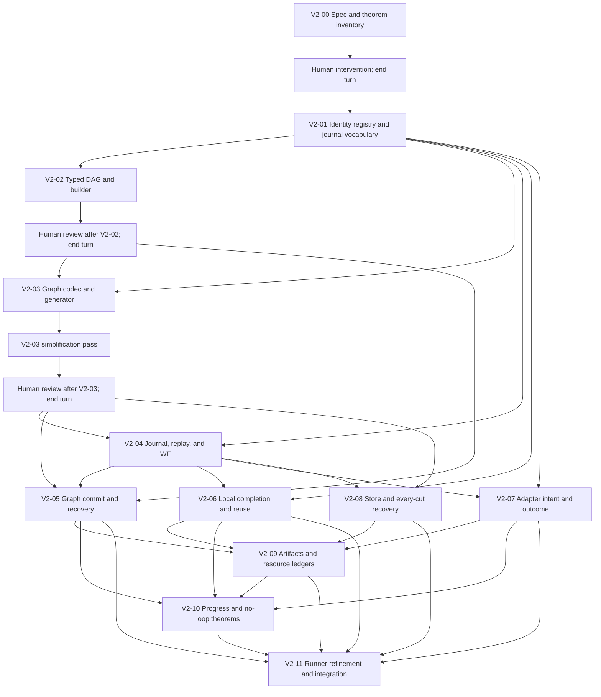

# F* v2 work DAG

At DAG creation all nodes were `not_started`. A node is ready exactly when all
listed prerequisites are `complete`, except that the human gate must wait for
the user's explicit review/resume. The IDs and dependency edges are stable
unless a logged DAG revision changes them.

| ID | Prerequisites | Scope and deliverable | Acceptance condition | Status |
|---|---|---|---|---|
| V2-00 | — | Inventory definitions, premises, P0–P14 targets, dependencies, and ambiguities; declare and typecheck the minimal F* kernel for indexed local work, external operations, dynamic graph generation, and dependent input/output families. | A traceable proof-obligation map exists, and a checked F* module expresses the three work constructors without `assume`/`admit`. | complete |
| V2-HUMAN | V2-00 | Stop for human review of V2-00's proof map and typed-kernel API. | The user has reviewed the result and explicitly resumed work; otherwise remain here and end the turn. | complete |
| V2-01 | V2-HUMAN | Formalize one derived durable work reference, pinned work/codec resolution, root input codec identity, P0, and minimal journal/action vocabulary. Keep one registry bundle for heterogeneous decoding; omit per-work typed wrappers and capture channels. | Declaration-phase acceptance: references derive from exact `Work`; journal fields contain only facts not derivable from the graph, registry, or allocation plan; registry identity-to-manifest, uniqueness, canonical-codec, and host-reload proof boundaries are explicit. Event identity is `(run, sequence)`. P0 remains open. | complete |
| V2-02 | V2-01 | Define finite typed DAG semantics, first-order wires, indexed constants, the minimal start/add/finish builder, and `dag_wf` over the pinned registry bundle. | Declaration-phase acceptance for review: unbounded finite-DAG expressibility and builder laws have theorem interfaces; the typed registry-resolution and typed-isomorphism gaps are explicit; no graph-size bound theorem is introduced. P1 remains open. | complete |
| V2-HUMAN-02 | V2-02 | Stop for human review of V2-02's typed DAG semantics, builder, and P1 proof work. | The user has reviewed the V2-02 summary and explicitly resumed work; otherwise remain here and end the turn. | complete |
| V2-03 | V2-01, V2-HUMAN-02 | Implement graph encoding/decoding, exact pinned-reference resolution, generator contracts, and allocation-accounted dynamic graph generation. Compare structural codec versus component-codec composition, decode-then-resolve versus typed registry decode, parser-inverse proofs versus constructor codec laws, and generator proof evidence versus a checked result package. | Deliver an executable F* graph codec, not a record that merely carries codec laws. Prove `decode(encode(g)) == Some(g)` for every `GraphDesc`, and prove that every accepted byte string re-encodes to exactly those bytes (including complete-input/canonical rejection). Separately implement executable `resolve_graph`: on root and generated paths it must either reject, or construct `graph_wf` by resolving every work ref and constant codec to the exact typed entry in the same pinned manifest. This is a constructive resolver requirement, not only a theorem signature; use manifest-owned schema/type evidence to transport existential indices. For every node, construct its input `Wiring` at the selected Work's exact type for every legal prior-port environment. A one-sample/runtime check is insufficient; resolution must not execute a Work to discover its output value. `PairWire` is structural pair construction; its dependent type follows from its recursively resolved children, so it has no separate codec identity. Identity-string equality alone is insufficient; no unchecked cast, new `assume`, or `admit` may stand in for codec, resolution, or generator-admission theorems. Execute a generator whose input changes graph shape; prove its emitted topology/indices and graph-local allocation plan. The plan is aligned one-for-one with descriptor node order. Establish its pinned generator-admission contract before commit. No graph-size bounds. | in_progress |
| V2-03-SIMPLIFY | V2-03 | Independently inspect V2-03 code/spec for removable abstractions, duplicate sources of truth, proof-hostile helpers, and missed graph-resolution obligations. In particular review ordered allocation-plan alignment, structural versus component graph codecs, parse-then-resolve versus typed decoding, redundant codec/parser lemmas, and the generator proof package. Revise and verify the result. | Record alternatives, simplifications adopted/rejected with reasons, and any remaining issue; re-run full F* verification after revisions. | not_started |
| V2-HUMAN-03 | V2-03-SIMPLIFY | Stop for human review of graph encoding/resolution/generation and simplification results. | User reviews V2-03 and simplifier report, then explicitly resumes; otherwise remain here and end turn. | not_started |
| V2-04 | V2-01, V2-HUMAN-03 | Define canonical journal events, abstract state, transition relation, replay, `WF`, and terminal states. | P3 states deterministic replay, legal-prefix preservation, `WF` preservation, and terminal absorption without making these top-level assumptions. | not_started |
| V2-05 | V2-HUMAN-03, V2-04 | Define pure graph-generation/commit sequencing and substitution of committed child graphs into the global DAG. | P4/P5 prove no generated node is enabled before commit, the exact `GraphDesc` result is committed, global DAG invariants are preserved, and recovery uses committed bytes without regeneration. No separate generation-intent event is added. | not_started |
| V2-06 | V2-01, V2-04 | Define local-node execution, completion journaling, and recovery behavior. | P6 ties a committed output to the exact pinned computation and proves completion is absorbing, so recovery reuses it and cannot authorize rerun. | not_started |
| V2-07 | V2-01, V2-04 | Define minimal adapter `CallIntent`/`CallOutcome`, validation, correlation, resumability, and liveness premises. | P7 uses occurrence as call key; intent stores only resume data; operation/input/maximum charge are derived from committed state; outcomes validate actual possibly nondeterministic replies and eventually commit under explicit adapter premises. | not_started |
| V2-08 | V2-HUMAN-03, V2-04 | Define the store refinement contract and connect abstract append history, durable bytes, load, and replay. | P10 and canonical-state results cover every process-exit cut, monotone committed prefixes, canonical decode/re-encode, and recovery to exactly the latest committed prefix under named store premises. | not_started |
| V2-09 | V2-05, V2-06, V2-07, V2-08 | Define artifact publication and occurrence-keyed charge/fuel ledgers across work, adapter, and graph transitions. | P8/P9 prove conservation, bounded single settlement, publication-before-reference, and stable artifact resolution under explicit contracts. | not_started |
| V2-10 | V2-05, V2-06, V2-07, V2-09 | Define enabled frontier and well-founded global progress measure. | P11/P12/P14 state no-stuck and no-infinite-successful-append results, plus conditional workflow termination under fairness, store, adapter, and finite-crash premises. | not_started |
| V2-11 | V2-05, V2-06, V2-07, V2-08, V2-09, V2-10 | Connect the concrete runner to the abstract transitions and close the theorem dependency matrix. | P13/P14 and the integrated proof chain show the runner performs only authorized actions and preserve all P0–P14 obligations; all remaining admissions are enumerated with owners and discharge conditions. | not_started |

## Dependency rule

The table and diagram are the machine-readable-in-spirit source for ordering.
Do not start a node while any prerequisite is incomplete or blocked. Independent
ready nodes may be selected in any order, but update status and logs before
starting. A blocked prerequisite blocks every dependent node. The graph itself
must remain acyclic. Human-review nodes are gates: after their prerequisites
complete, set the gate to `awaiting_human` and end the turn. Set it to
`complete` only when the user explicitly approves or resumes. `V2-HUMAN`
gates V2-01 after V2-00; `V2-HUMAN-02` gates V2-03 after V2-02;
`V2-HUMAN-03` gates every V2-03 dependent after simplification, so no
graph-dependent work proceeds before review. For this staged
top-down pass, V2-01/V2-02 `complete` means the declared contracts and proof
interfaces are reviewable and all holes are visible. It does not supersede
implementation-spec obligations P0/P1: their remaining assumptions and
admissions are explicit in `node_summaries.md` and must be discharged later.

