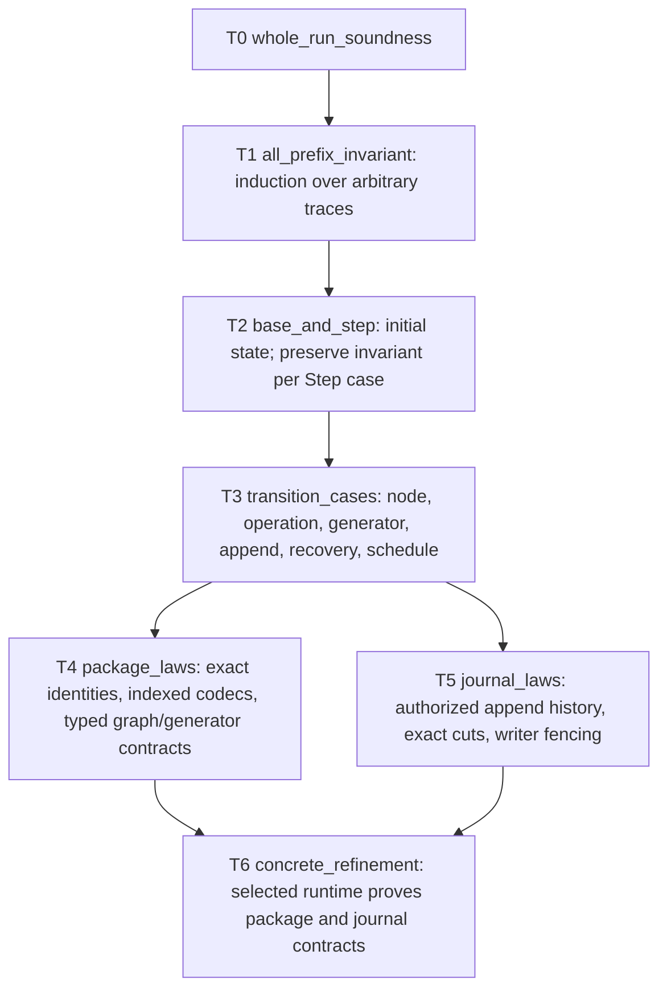

# Previous F* workflow v2 system specification and theorem spline

**Status: previous proposal, under reconciliation.** The current working
design is the [event-driven state-machine API WIP](state_machine_api_wip.typ). The
theorem shapes below record the earlier versioned-package design; they are not
the current authority. Earlier package-owned drafts are preserved under
[archive/2026-10-14](../archive/2026-10-14/README.md), and the old task table
remains in [state/work_dag.md](../state/work_dag.md) for reference.

## 1. Intention

Given a typed root graph and an exact set of pinned work packages, the
abstract machine executes the graph, records enough durable data to resume,
and returns only a value at the root's declared dependent output type. The
primary correctness result is one theorem about the entire run, including
every committed journal prefix and every permitted restart cut.

The design is parametric in node and operation packages. Each package owns
the local facts it can establish: indexed value decoding, local computation,
operation request/reply validation, and generator graph/plan validity. The
machine proves facts that span packages or events: authorization at the
current journal head, unique occurrences, graph installation before child
visibility, aggregate accounting, prefix recovery, and schedule safety.

No universal schema language or type serializer is required. Durable graph
syntax and values are bytes. A package-specific graph decoder returns a
`TypedGraph` or rejects the bytes; F*'s type checker and the package's proved
contract establish the typing facts. Proof witnesses and executable code are
not journal fields. A decoder may parse and construct a witness during
recovery; the machine does not rerun semantic guards or rebuild a universal
type calculus.

The theorem is intended to be generic over every package bundle satisfying
the stated contracts. A contract is supplied as a proof-bearing value and
must be verified at package construction or identified as part of the
explicit trusted boundary. A Boolean flag or a package name alone is not a
proof.

## 2. Mathematical interface

The following names define the specification vocabulary. Their concrete F*
representations are the first formalization work; these definitions must not
be weakened to make the main theorem pass.

### 2.1 Package and root parameters

Let `B` be a closed bundle of exact, versioned packages. Let the root input
be `x : I` and the declared root output family be `O : I -> Type0`. A root
value is a package-owned typed graph:

```text
root : TypedGraph(B, x, O)
```

`TypedGraph(B, x, O)` carries a durable descriptor and an F* witness that
the exact descriptor resolves against `B`, every input wire has the input
type of its exact package, every node output has that package's dependent
output type for that wire's value, and the root output wire has type `O x`.
The witness is ghost/runtime-erased and is not serialized.

The bundle contract `BundleLaws(B)` contains, at minimum:

1. **Exact resolution.** Every durable work reference selects exactly one
   package version and its associated codec, callback, and contract proofs.
2. **Indexed codecs.** For each package with input `A` and output family
   `Q : A -> Type0`, its decoder has shape
   `decode : a:A -> Bytes -> option (Q a)`. Round-trip and accepted-byte
   canonicality are proved for that exact codec.
3. **Local code.** The package result at input `a` has type `Q a`, and its
   value codec describes that same indexed result.
4. **External operations.** Request, stable key, reply validator, terminal
   receipt, retry/reconciliation behavior, and charge are bound by one
   package contract. A decoded reply alone does not prove an external effect.
5. **Generators.** For every input and permitted allocation, the exact
   generator returns a `TypedGraph` and a valid local plan. This is universal
   over its declared domain, not a property inferred from sample executions.
6. **Graph codecs.** A graph decoder has a typed result such as
   `decode_graph : x:I -> Bytes -> option (TypedGraph(B,x,O))`. Its laws bind
   accepted bytes to the exact durable descriptor and pinned package
   references, and require every graph the package emits to round-trip.

The journal contract `JournalLaws(J,B)` identifies the persistence boundary:
trusted valid genesis; a private append path that consumes authorization at
the exact current head; atomic visibility of a complete committed prefix;
no mutation, reordering, rollback, or lost committed append; and fencing of
old writers before a recovery cut. It also returns the latest complete
canonical prefix at a cut together with the ghost authorization history for
that prefix. A concrete journaler must prove that it implements this contract
or be explicitly included in the trusted computing base.

The abstract read result is a `LoadedPrefix`: exact bytes and decoded events,
proof that they are the latest complete canonical prefix, and a ghost
`AuthorizedHistory` witness. The witness is a static fact about the
journaler's authorized append history, not data stored alongside the events.
If the host cannot establish this relation after restart, the guarantee must
be an explicit trust premise or the design must validate imported history.

### 2.2 Machine state and invariant

`State(B,J)` is the abstract machine projection of one run. It includes the
committed journal position, installed graph occurrences, ready/running/
completed occurrence states, outstanding operation intents, resource
claims, charge and fuel ledgers, and current writer epoch. It need not retain
all proof terms at runtime; the F* model may carry them in ghost fields.

`Step(B,J,s,s')` is one permitted abstract transition: scheduling, local
completion, operation intent or receipt, generator graph commit, append,
crash, or recovery. A trace is any finite sequence of such steps from the
initial state. The relation describes permitted machine actions and package
responses; it does not assume the system invariant it is meant to prove.

Define `SystemInvariant(B,J,root,s)` as the conjunction of these independently
stated properties:

- **Authorized exact prefix:** the durable journal is exactly the latest
  complete prefix accepted by `J`; each extension has an authorization
  witness for its precise preceding head, and replay projection equals `s`.
- **Typed installed graphs:** every committed graph occurrence resolves to
  its exact pinned package graph and has `TypedGraph` evidence for its root
  input and output family. Its descriptor is the one committed in the
  journal.
- **Typed, sourced completions:** every completed occurrence has the exact
  input associated with its typed graph port. A local result is the result
  of its pinned code package; an external result is validated against its
  pinned request and terminal receipt. Stored output bytes decode at that
  exact input to the committed typed value.
- **Occurrence and visibility safety:** occurrence identities are unique;
  a child is schedulable only after its containing graph and allocation plan
  are committed; committed work is absorbing and cannot be dispatched
  again; a pending external intent resumes under its exact stable key and
  request binding.
- **Global accounting:** committed reservations, settlements, allocations,
  and remaining resources equal the corresponding machine ledgers, with no
  charge settled more than once.

`SystemInvariant` is not defined as “the journal checker accepts the log.”
Its semantic facts are established at genesis and preserved at each
authorized transition. The authorization history is ghost evidence carried
by the journal boundary; proof terms are not durable journal fields. Recovery
parses/framing-checks bytes, decodes values at their known indexed inputs,
and folds the exact prefix to reconstruct the typed state. This data
reconstruction is required. It does not re-run historical event guards, user
callbacks, graph compatibility checks in a machine-owned calculus, or
external effects. A package graph decoder may run to reconstruct a typed
graph from graph bytes; its typed result and package law supply the typing
evidence.

## 3. Primary theorem: whole-run soundness

Let `state_at(root, trace, k)` be the state after the first `k` transitions,
where `0 <= k <= length(trace)`. Let `Successful(root, s, y)` mean that `s`
is terminal-success and exposes `y` as the root output value. The principal
theorem is:

```text
T0 whole_run_soundness:
  forall B J I O x root trace.
    BundleLaws(B)
    -> JournalLaws(J, B)
    -> root : TypedGraph(B, x, O)
    -> Trace(B, J, initial_state(root), trace)
    -> (forall k. 0 <= k <= length(trace) ->
          SystemInvariant(B, J, root,
            state_at(root, trace, k)))
       /\ (forall k y. 0 <= k <= length(trace)
            -> Successful(root, state_at(root, trace, k), y)
            -> y : O x
               /\ y = committed_value_of(root.output_wire,
                                           state_at(root, trace, k)))
```

The quantification over `B`, `J`, and all permitted traces is deliberate:
the theorem applies to any exact package bundle and any schedule, including
out-of-order independent completions and restart cuts, as long as their
proof-bearing contracts hold. It states safety for every finite prefix.
It makes no fairness or service-availability assumption. Termination is a
separate conditional result below.

This is the first theorem to formalize. Its contract is strong enough to
drive the design: if some desired guarantee cannot be derived from `T0` and
the listed package/journal contracts, that guarantee or its missing premise
must be made explicit before implementation.

At the first formalization checkpoint, `T0` is the proposition/goal. No F*
interface may expose an unproved `T0` declaration as if callers could rely on
it. Its proof is complete only when the spline supplies an inhabitant without
`admit`, `assume`, or a trusted axiom for the result.

## 4. Top-down theorem spline

The spline starts with `T0` and refines its proof obligations. A downward
arrow means “prove the theorem above by establishing the obligations below.”
It does not mean that implementation should proceed by adding assumptions to
an unfinished lower-level lemma.



### T1 — Prefix induction

Prove one invariant for every prefix, not just the terminal result:

```text
T1 all_prefix_invariant:
  BundleLaws(B) -> JournalLaws(J,B)
  -> Initial(root, s0)
  -> TraceSteps(Step(B,J), s0, trace)
  -> (forall k. k <= length(trace) ->
        SystemInvariant(B,J,root,state_at(trace,k)))
```

The proof is forward induction on `k`. It does not quantify over a favored
completion order; `Step` admits every schedule allowed by the machine.
`T0` follows by instantiating this theorem and applying the root-output
projection clause of the invariant plus typed graph evaluation.

### T2 — Base case and one-step preservation

Prove exactly two general lemmas:

```text
T2a initial_state_invariant:
  BundleLaws(B) -> JournalLaws(J,B) -> RootWF(B,root)
  -> SystemInvariant(B,J,root,initial_state(root))

T2b step_preserves_invariant:
  BundleLaws(B) -> JournalLaws(J,B)
  -> SystemInvariant(B,J,root,s)
  -> Step(B,J,s,s')
  -> SystemInvariant(B,J,root,s')
```

`T2b` is split by the constructors of `Step`, so every state change has one
visible preservation proof. No theorem assumes `SystemInvariant(s')` or
uses an admitted transition case. Given `T2a` and `T2b`, `T1` is ordinary
induction on the finite trace length.

### T3 — Preservation obligations by transition

These are the cases needed to prove `T2b`:

| Case theorem | Obligation to prove |
|---|---|
| `node_completion_preserves` | Bind input and output bytes to the same exact occurrence and pinned indexed codec; establish decoded result equals the local package result; commit once; make completion absorbing. |
| `operation_receipt_preserves` | Bind intent, stable key, exact request, terminal receipt, validated result, and charge to one occurrence; retries/reconciliation preserve one logical effect and one settlement. |
| `generator_install_preserves` | Use the exact generator's universal graph/plan law; authorize and commit graph bytes and plan at the current head before exposing children; prove whole-run occurrence names remain unique and allocation lifting preserves global accounting. |
| `append_preserves` | Consume an authorization witness for the precise current head; a successful append extends the prefix and all aggregate ledgers once; a stale or failed append changes no committed state. |
| `recovery_preserves` | Load the exact latest complete prefix with its ghost history, fence the former writer, fold the prefix to the same projection, and reconstruct each committed graph through its pinned typed graph decoder. Do not rerun committed work or historical semantic guards. |
| `schedule_preserves` | For any interleaving of enabled completions and append attempts, preserve unique claims, exact ready inputs, serial current-head commits, ledger equations, and commit-before-visibility. |

These names are proof targets. Some can be grouped in the final F* modules,
but the obligations must remain explicit and composable.

### T4 — Package-owned laws and graph typing

The machine consumes contracts; each exact package proves its local law.
The top-level graph typing rule is the ordinary F* dependent type of the
constructed graph. For each edge, the producer output at that exact input
wire must be convertible to the consumer input type or accompanied by an
F* equality transport. This is required for every environment represented
by the graph's dependent telescope. For example, `Vec n -> Vec 3` fails for
unconstrained `n`; it is accepted when the graph's input context proves
`n = 3`. Sampling one runtime environment at `n = 3` is not evidence.

The package theorems consumed by `T3` are:

- exact durable identity resolves to the same law-bearing package after
  reload;
- indexed value codec round-trip and canonicality at the exact input;
- local code returns the exact indexed result;
- operation contract binds requests, keys, receipts, effects, validation,
  retries, and charges;
- generator law holds for every legal input and allocation and returns a
  typed graph and valid plan;
- graph codec preserves the exact durable descriptor and resolves all refs
  against the exact bundle, with round-trip coverage for every graph it emits.

No package proves global claim uniqueness, a sum over all charges, exact
current-head commit, or cross-graph occurrence uniqueness. Those are T3
machine obligations.

### T5 — Journal authorization and recovery laws

Define the ghost history predicate by induction rather than by rechecking
events on restart:

```text
AuthorizedHistory(B, []) = TrustedGenesis(B)
AuthorizedHistory(B, events ++ [e]) =
  AuthorizedHistory(B, events)
  /\ AppendPermit(B, fold(events), e)
  /\ committed_at_exact_head(events, e)
```

`AppendPermit` binds the event to the state obtained by folding the exact
preceding prefix, the exact package and occurrence, the input and output or
graph bytes, and the applicable transition rule. A recovery result carries
this derivation as ghost evidence in the abstract contract; the proof itself
is not written to storage. A selected journaler must refine that contract by
preserving the ghost association between successful private append calls and
the immutable persisted prefix. It does not rerun `AppendPermit` against
every old event. Byte framing, complete-input parsing, indexed value decode,
and any necessary package graph decoding still happen at the boundary.

The contract must include valid genesis and exclusive append authority; a
claim that bytes are immutable by itself does not establish that recorded
events were authorized. The concrete refinement proof identifies which
parts are proved by the host journaler and which are trusted.

### T6 — Concrete refinement and trust audit

For a chosen controller, journaler, codecs, package registry, executors, and
operation adapters, prove a representation relation to `State(B,J)`. Show
that each concrete operation either implements a permitted `Step` or leaves
the committed state unchanged. This is where physical append atomicity,
package identity across restart, and old-writer fencing are established.
The generic theorem does not silently certify an unverified host runtime.

## 5. Separate progress theorem

Safety does not imply that a run finishes. If termination is a product
requirement, state it as a separate theorem with explicit progress premises:

```text
T7 conditional_termination:
  BundleLaws(B)
  -> JournalLaws(J,B)
  -> RootWF(B,root)
  -> finite_fuel(root)
  -> enabled_work_is_eventually_scheduled
  -> local_code_and_journal_calls_terminate
  -> each external key eventually yields a terminal receipt
  -> only finitely many crashes
  -> eventually terminal_success_or_declared_failure
```

The fairness and availability assumptions belong only to `T7`, not `T0`.

## 6. Formalization order and acceptance

The first F* change should encode the vocabulary and signature of `T0`,
including the package, journal, root, trace, state, and invariant predicates
needed to state it. Then formalize `T1`, `T2a`, and the type of `T2b`; only
after that fill the transition cases and package/journal contracts they
require. Do not start by implementing a schema replacement or proving a
low-level codec theorem whose role in `T0` is not stated.

Acceptance for the first specification milestone:

1. `T0` is expressible as a proposition/goal in F*. No unproved exported
   theorem or axiom stands in for the result; the spline states what will
   prove it.
2. Every premise is a named root/package/journal/trace contract; no premise
   is the whole conclusion restated under another name.
3. The invariant clauses are independently meaningful and imply typed
   successful output and exact-prefix recovery.
4. The generic statement quantifies over all permitted package bundles and
   schedules. Package-specific proofs instantiate it; the machine does not
   define a universal schema calculus.
5. Every concrete trusted premise is identified at `T6`, not hidden inside
   an abstract type or a callback name.

Current F* modules remain the pre-redesign baseline. In particular, the
source still has schema-specific modules and admitted builder laws. Their
current declarations and historical theorem audit are retained in the
archive; they are not evidence that any theorem in this spline has been
proved.

## 7. Historical detail and design register

The archived package-owned draft retains prior codec shapes, typed telescope
details, vector examples, no-tampering analysis, source theorem links, P0–P16
obligation map, and open decisions D1–D7. The archived work DAG retains its
former dependency graph and acceptance criteria. Treat both as research
history where they agree with this top-level specification. If they conflict,
this file is authoritative; revise this file first and record the change in
the active work DAG.
